# HRIS Backend

REST API dan server WebSocket untuk sistem HRIS (Human Resource Information System) yang dikembangkan sebagai bagian dari program Praktik Kerja Lapangan di PT Awan Komputasi Teknologi (Awanio).

Modul yang tersedia: autentikasi (termasuk verifikasi email dan reset password), pengelolaan akun, manajemen karyawan dan organisasi, jadwal kerja, absensi (termasuk absensi offline), cuti beserta saldo dan lampirannya, notifikasi real-time lewat WebSocket, log aktivitas, serta kontrol fitur berbasis jabatan.

## Daftar Isi

- [Tech Stack](#tech-stack)
- [Struktur Proyek](#struktur-proyek)
- [Konvensi Kode](#konvensi-kode)
- [Instalasi dan Menjalankan](#instalasi-dan-menjalankan)
- [Deploy ke VM dengan Docker](#deploy-ke-vm-dengan-docker)
- [Konfigurasi Environment](#konfigurasi-environment)
- [Pengujian](#pengujian)
- [Format Respons dan Error](#format-respons-dan-error)
- [Daftar Endpoint](#daftar-endpoint)
- [Notifikasi Real-time](#notifikasi-real-time)
- [Keamanan](#keamanan)
- [Redis](#redis)
- [Log Terminal](#log-terminal)
- [Dokumentasi API (OpenAPI)](#dokumentasi-api-openapi)
- [Rate Limit](#rate-limit)
- [Perlindungan dari Permintaan Bersamaan](#perlindungan-dari-permintaan-bersamaan)
- [Deteksi Edit Bersamaan](#deteksi-edit-bersamaan)
- [Pengiriman Email](#pengiriman-email)
- [Karyawan](#menambah-karyawan-satu-atau-banyak)
- [Absensi](#aturan-absensi)
- [Otorisasi Berbasis Jabatan](#otorisasi-berbasis-jabatan)
- [Struktur Organisasi](#struktur-organisasi)
- [Cuti](#alur-persetujuan-cuti)
- [Alur Akun](#alur-verifikasi-email)
- [Batasan yang Diketahui](#batasan-yang-diketahui)
- [Diagram Alur Sistem](#diagram-alur-sistem)

## Tech Stack

| Komponen         | Teknologi                                     |
| ---------------- | --------------------------------------------- |
| Runtime          | Node.js 22                                    |
| Bahasa           | TypeScript (`NodeNext`, hasil build CommonJS) |
| Framework        | Express 5                                     |
| Database         | PostgreSQL (Supabase)                         |
| Driver DB        | node-postgres (`pg`), tanpa ORM               |
| Penyimpanan file | Supabase Storage                              |
| Real-time        | WebSocket (`ws`)                              |
| Autentikasi      | JSON Web Token                                |
| Hashing          | Argon2id                                      |
| Validasi         | Zod                                           |
| Unggah berkas    | Multer                                        |
| Logging          | Pino                                          |
| Pengiriman email | Resend                                        |
| Keamanan HTTP    | Helmet, CORS                                  |
| Unit test        | Jest, Supertest                               |
| Formatting kode  | Prettier                                      |

## Struktur Proyek

```
src/
├── app.ts              # Susunan Express: helmet, CORS, rute, error handler
├── server.ts           # Titik masuk: koneksi DB, HTTP, WebSocket, pembersihan notifikasi
├── config/             # env, koneksi database, logger, daftar origin yang diizinkan
├── route/              # Pemetaan URL ke middleware dan controller
├── middlewares/        # rateLimit, authenticate, requireFeature, validate, upload, error handler
├── controller/         # Alur per endpoint: memeriksa aturan bisnis lalu memanggil model
├── models/             # Seluruh query SQL, satu berkas per tabel
├── schema/             # Skema Zod untuk body, query, dan parameter
├── helpers/            # Logika bersama: waktu, status, email, penyimpanan, notifikasi
├── realtime/           # Server WebSocket, registri soket, jembatan antar-instance
└── scripts/            # Seed data contoh (tidak ikut di repositori)
tests/                  # Mengikuti struktur src/ satu per satu
```

Request API mengikuti alur umum berikut; autentikasi dan pemeriksaan fitur hanya dipasang pada endpoint yang membutuhkannya:

```
route → rateLimit → authenticate → requireFeature → validate → controller → model → PostgreSQL
                                                                     │
                                                                     └─→ helpers/notify → realtime
```

Setiap lapisan punya satu tanggung jawab. Controller tidak menulis SQL, model tidak tahu soal HTTP, dan route tidak berisi logika.

## Konvensi Kode

| Aturan                                                                                                                          | Alasan                                                                                                                                                            |
| ------------------------------------------------------------------------------------------------------------------------------- | ----------------------------------------------------------------------------------------------------------------------------------------------------------------- |
| Pesan untuk pengguna dan log ditulis dalam bahasa Inggris, komentar kode dalam bahasa Indonesia                                 | Pesan dibaca aplikasi dan pengguna, komentar dibaca tim                                                                                                           |
| Nama variabel, fungsi, dan tipe dalam bahasa Inggris                                                                            | Konsisten dengan pustaka dan kolom database                                                                                                                       |
| Import lokal selalu diakhiri `.js`                                                                                              | Diwajibkan resolusi modul `NodeNext`                                                                                                                              |
| Query selalu memakai parameter (`$1`) beserta cast eksplisit (`$1::uuid`)                                                       | Mencegah SQL injection dan salah tebak tipe oleh PostgreSQL                                                                                                       |
| Update hanya menerima kolom dari daftar putih (`UPDATABLE_COLUMNS`), lewat `updateVersioned` di `src/models/versionedUpdate.ts` | Field yang tidak diizinkan tidak mungkin ikut tersimpan, dan pemeriksaan versi `updated_at` sama di semua tabel                                                   |
| Penulisan ke lebih dari satu tabel dibungkus `withTransaction` dari `src/helpers/transaction.ts`, bukan `BEGIN`/`COMMIT` manual | Tidak ada data setengah jadi bila salah satu langkah gagal. Koneksi baru diambil setelah validasi selesai, dan koneksi yang gagal di-`ROLLBACK` dibuang dari pool |
| Pekerjaan lambat (hash password, unggah berkas, kirim email) dikerjakan di luar transaksi                                       | Koneksi database tidak tertahan dan kunci baris tidak dipegang lama                                                                                               |
| Tanggal "hari ini" selalu menurut `TIMEZONE` kantor (`todayInOfficeZone`), bukan `new Date().toISOString()`                     | Antara pukul 00.00 dan 07.00 WIB tanggal UTC masih tertinggal sehari                                                                                              |
| Respons create dan update berbentuk `{ success, message, data }`                                                                | Seragam dengan endpoint lain, sehingga frontend bisa langsung menampilkan `message`                                                                               |
| Error dilempar lewat `src/helpers/appError.ts`                                                                                  | Satu bentuk respons error untuk seluruh aplikasi                                                                                                                  |
| Pengambilan karyawan pemilik request lewat `src/helpers/requestEmployee.ts`                                                     | Diambil sekali per request dan dipakai bersama middleware dan controller                                                                                          |
| Metadata daftar memakai `paginationMeta` dari `src/helpers/pagination.ts`                                                       | Rumus `total_pages` sama di semua endpoint; data kosong berarti `0`                                                                                               |
| Query yang tidak saling bergantung dijalankan bersamaan dengan `Promise.all`                                                    | Waktu tunggu permintaan mengikuti query terlama, bukan jumlah semuanya                                                                                            |

## Instalasi dan Menjalankan

Prasyarat: Node.js 22.23.4 atau lebih baru di jalur 22 (tersedia di `.nvmrc`, jalankan `nvm use`). Versi di bawahnya terdampak Security Release 21 Oktober 2026, termasuk CVE-2026-111497 (Brotli).

```bash
git clone https://github.com/DeadBear34/hris-backend.git
cd hris-backend
nvm use
npm install
cp .env.example .env    # lalu isi nilainya
```

```bash
npm run dev      # mode pengembangan dengan auto-reload
npm run build    # kompilasi TypeScript ke folder dist
npm start        # menjalankan hasil kompilasi
```

Verifikasi server berjalan:

```bash
curl http://localhost:8080/health
```

HTTP dan WebSocket berbagi port yang sama. WebSocket tersedia di `ws://localhost:8080/ws`.

| Perintah             | Kegunaan                                                    |
| -------------------- | ----------------------------------------------------------- |
| `npm run dev`        | Menjalankan server dengan `tsx watch`                       |
| `npm run build`      | Mengompilasi TypeScript ke JavaScript                       |
| `npm start`          | Menjalankan hasil build                                     |
| `npm test`           | Menjalankan seluruh pengujian                               |
| `npm run test:watch` | Menjalankan pengujian setiap berkas berubah                 |
| `npm run format`     | Merapikan kode `src` dan `tests` dengan Prettier            |
| `npm run typecheck`  | Memeriksa tipe serta impor dan variabel yang tidak terpakai |
| `npm run seed`       | Mengisi database dengan data contoh                         |

Kode mati dicegah oleh compiler: `tsconfig.json` mengaktifkan `noUnusedLocals` dan `noUnusedParameters`, sehingga impor, variabel, atau parameter yang tidak terpakai membuat `tsc` dan CI gagal. Parameter yang memang wajib ada tapi tidak dipakai, misalnya `_req` di handler Express, diberi awalan garis bawah.

## Deploy ke VM dengan Docker

Production berjalan di VM sebagai dua container lewat `docker-compose.yml`: `backend` dan `redis`. Database tetap di luar container, yaitu PostgreSQL yang alamatnya diisi di `DATABASE_URL`.

```
Internet ──HTTPS──▶ Nginx/Caddy di VM ──▶ 127.0.0.1:8080 ──▶ container backend ──▶ container redis
                                                                  │
                                                                  └──▶ PostgreSQL (DATABASE_URL)
```

| Berkas               | Isi                                                                                                                                       |
| -------------------- | ----------------------------------------------------------------------------------------------------------------------------------------- |
| `Dockerfile`         | Build tiga tahap: kompilasi TypeScript, dependensi production, lalu image akhir `node:22-bookworm-slim` yang berjalan sebagai user `node` |
| `.dockerignore`      | Menjaga `.env`, `seed.ts`, `tests`, dan `.git` tidak ikut masuk image                                                                     |
| `docker-compose.yml` | Backend dan Redis, rotasi log, healthcheck, restart otomatis                                                                              |

### Pertama kali

Prasyarat di VM: Docker Engine dengan plugin Compose, serta git.

```bash
git clone https://github.com/DeadBear34/hris-backend.git
cd hris-backend
cp .env.example .env.production    # isi nilainya, lihat di bawah
docker compose up -d --build
docker compose ps                  # backend dan redis harus "healthy"
curl http://127.0.0.1:8080/health
```

Isi `.env.production` sama dengan `.env`, dengan catatan berikut:

| Variabel                        | Nilai di VM                                                          |
| ------------------------------- | -------------------------------------------------------------------- |
| `NODE_ENV`, `PORT`, `REDIS_URL` | Tidak perlu diisi, sudah ditetapkan `docker-compose.yml`             |
| `TRUST_PROXY`                   | `1`, karena ada satu reverse proxy di depan backend                  |
| `APP_URL`                       | Alamat frontend tanpa garis miring di akhir, dipakai di tautan email |
| `CORS_ORIGIN`                   | Alamat frontend, boleh lebih dari satu dipisah koma                  |
| `CRON_SECRET`                   | String acak minimal 16 karakter, dipakai job penutup hari            |
| `LOG_LEVEL`                     | `info`                                                               |

`.env.production` tidak ikut git (`.env.*` ada di `.gitignore`) dan tidak ikut image (`.dockerignore`). Rahasia hanya ada di VM.

### Cloudflare Tunnel (dipakai di VM saat ini)

Container `cloudflared` di `docker-compose.yml` membuka koneksi **keluar** ke Cloudflare, sehingga backend dapat diakses lewat HTTPS di domain publik tanpa membuka port apa pun di VM. Sertifikat HTTPS dan proteksi DDoS diurus Cloudflare, dan WebSocket `/ws` didukung tanpa pengaturan tambahan.

| Pengaturan     | Tempat                                                                                |
| -------------- | ------------------------------------------------------------------------------------- |
| `TUNNEL_TOKEN` | `.env.production` di VM, diambil dari dashboard Zero Trust saat membuat tunnel        |
| Rute domain    | Dashboard Zero Trust → tunnel → _Public Hostname_: service `HTTP`, URL `backend:8080` |
| `TRUST_PROXY`  | `1`, karena `cloudflared` satu-satunya proxy yang langsung berhadapan dengan backend  |

Jangan pasang _Access application_ (halaman login Zero Trust) pada hostname API. Panggilan dari frontend akan tertahan di halaman login itu.

### Reverse proxy (alternatif tanpa Cloudflare)

Backend hanya membuka port ke `127.0.0.1`, jadi tidak bisa diakses langsung dari internet. HTTPS dipegang reverse proxy. Contoh Nginx:

```nginx
server {
    listen 443 ssl;
    server_name api.contoh.com;
    # ssl_certificate dan ssl_certificate_key dari Certbot

    client_max_body_size 10m;   # unggah foto dan lampiran cuti

    location / {
        proxy_pass http://127.0.0.1:8080;
        proxy_set_header Host $host;
        proxy_set_header X-Forwarded-For $proxy_add_x_forwarded_for;
        proxy_set_header X-Forwarded-Proto $scheme;

        # Notifikasi real-time memakai WebSocket di /ws
        proxy_http_version 1.1;
        proxy_set_header Upgrade $http_upgrade;
        proxy_set_header Connection "upgrade";
        proxy_read_timeout 3600s;
    }
}
```

Tanpa tiga baris WebSocket itu, API tetap jalan tetapi notifikasi real-time selalu gagal tersambung.

### Job penutup hari

Railway tidak lagi memanggil endpoint ini, jadi jadwalnya dipasang di crontab VM (`crontab -e`). Contoh setiap hari pukul 23.30 WIB:

```cron
CRON_TZ=Asia/Jakarta
30 23 * * * curl -fsS -X POST -H "x-cron-secret: ISI_CRON_SECRET" http://127.0.0.1:8080/api/v1/attendances/close-day > /dev/null
```

### Memperbarui ke versi baru

```bash
git pull
docker compose up -d --build    # hanya backend yang dibangun ulang, Redis tetap jalan
docker image prune -f           # membuang image lama
```

Saat diganti, container lama menerima SIGTERM dan menutup koneksi dengan rapi. `init: true` dan `CMD ["node", ...]` memastikan sinyal itu benar-benar sampai ke Node.

### CI/CD dengan GitHub Actions

| Workflow                       | Kapan                                        | Isi                                                                                                                     |
| ------------------------------ | -------------------------------------------- | ----------------------------------------------------------------------------------------------------------------------- |
| `.github/workflows/ci.yml`     | Push ke `develop`, setiap pull request       | `tsc --noEmit`, `npm test`, build image Docker tanpa dikirim                                                            |
| `.github/workflows/deploy.yml` | Push ke `main`, atau manual dari tab Actions | CI, lalu image dikirim ke `ghcr.io/deadbear34/hris-backend:<sha>`, lalu SSH ke VM menjalankan `scripts/deploy.sh <sha>` |

`scripts/deploy.sh` di VM memperbarui `docker-compose.yml` dari `main`, menarik image dengan tag commit tersebut, menyalakannya, lalu menunggu `/health` hingga 60 detik. Bila tidak sehat, workflow gagal dan 50 baris log terakhir ikut tampil.

Secret di environment `production` (Settings → Environments):

| Secret           | Isi                                                    |
| ---------------- | ------------------------------------------------------ |
| `VM_HOST`        | Alamat IP VM                                           |
| `VM_USER`        | User SSH di VM                                         |
| `VM_SSH_KEY`     | Kunci privat khusus deploy, bukan kunci pribadi        |
| `VM_KNOWN_HOSTS` | Baris kunci publik VM dari `ssh-keygen -F <alamat-vm>` |

Kunci deploy didaftarkan di `~/.ssh/authorized_keys` VM dengan batasan, sehingga hanya bisa menjalankan skrip deploy:

```
command="bash /home/awanio/hris-backend/scripts/deploy.sh",no-port-forwarding,no-agent-forwarding,no-X11-forwarding,no-pty ssh-ed25519 AAAA... github-actions-deploy
```

**Rollback** ke versi sebelumnya, di VM: `bash scripts/deploy.sh <sha-commit-lama>`. Daftar sha ada di tab Actions atau halaman package di GitHub.

### Log dan pemantauan

| Perintah                                 | Kegunaan                         |
| ---------------------------------------- | -------------------------------- |
| `docker compose logs -f backend`         | Mengikuti log backend            |
| `docker compose logs --since 1h backend` | Log satu jam terakhir            |
| `docker compose ps`                      | Status dan health tiap container |
| `docker compose restart backend`         | Menyalakan ulang backend saja    |

Log berformat JSON, satu baris per kejadian. Docker menyimpannya di disk VM dengan batas 5 berkas × 20 MB per container, dan berkas tertua dibuang otomatis. Riwayat aktivitas pengguna tetap permanen di tabel `activity_logs`.

## Konfigurasi Environment

| Variabel                    | Wajib | Default                        | Keterangan                                                                             |
| --------------------------- | ----- | ------------------------------ | -------------------------------------------------------------------------------------- |
| `NODE_ENV`                  | tidak | `development`                  | `development`, `test`, atau `production`                                               |
| `PORT`                      | tidak | `8080`                         | Port HTTP sekaligus WebSocket, harus di antara 1 dan 65535                             |
| `CORS_ORIGIN`               | tidak | `http://localhost:5173`        | Origin frontend yang diizinkan, boleh lebih dari satu dipisah koma                     |
| `LOG_LEVEL`                 | tidak | `info`                         | `debug`, `info`, `warn`, `error`, atau `silent`. Lihat Log Terminal                    |
| `DATABASE_URL`              | ya    | —                              | Connection string PostgreSQL, lihat catatan di bawah                                   |
| `JWT_SECRET`                | ya    | —                              | Kunci penandatangan token, minimal 32 karakter                                         |
| `JWT_EXPIRES_IN`            | tidak | `24h`                          | Masa berlaku access token                                                              |
| `RESEND_API_KEY`            | tidak | —                              | Kunci API Resend, wajib kalau email benar-benar dikirim                                |
| `MAIL_DRIVER`               | tidak | mengikuti `NODE_ENV`           | `log` untuk mencetak email ke log, `resend` untuk mengirim sungguhan                   |
| `MAIL_FROM`                 | tidak | `HRIS <onboarding@resend.dev>` | Alamat pengirim email                                                                  |
| `APP_URL`                   | tidak | `http://localhost:5173`        | Alamat frontend, dipakai menyusun tautan di dalam email                                |
| `SUPABASE_URL`              | tidak | —                              | Alamat proyek Supabase, wajib untuk lampiran cuti dan foto profil                      |
| `SUPABASE_SERVICE_ROLE_KEY` | tidak | —                              | Service role key Supabase, wajib untuk lampiran cuti dan foto profil                   |
| `SUPABASE_STORAGE_BUCKET`   | tidak | `leave-attachments`            | Nama bucket privat penyimpan lampiran cuti                                             |
| `SUPABASE_PHOTO_BUCKET`     | tidak | `employee-photos`              | Nama bucket publik penyimpan foto profil karyawan                                      |
| `TIMEZONE`                  | tidak | `Asia/Jakarta`                 | Zona waktu kantor, menjadi acuan seluruh aturan jam kerja                              |
| `CRON_SECRET`               | tidak | —                              | Rahasia job penutup hari, minimal 16 karakter, wajib untuk absensi                     |
| `RATE_LIMIT_ENABLED`        | tidak | menyala, kecuali saat test     | `true` atau `false`, lihat [Rate Limit](#rate-limit)                                   |
| `QA_TOOLS_ENABLED`          | tidak | menyala, kecuali di production | `true` atau `false`, lihat [Kode verifikasi untuk QA](#kode-verifikasi-untuk-qa)       |
| `TRUST_PROXY`               | tidak | mati                           | Jumlah proxy di depan server, wajib bila memakai reverse proxy                         |
| `REDIS_URL`                 | tidak | —                              | `redis://` atau `rediss://`, kosong berarti Redis tidak dipakai; lihat [Redis](#redis) |

Variabel yang ditulis tanpa nilai di `.env` diperlakukan sebagai belum diisi, sehingga nilai bawaannya tetap dipakai. Nilai yang tidak valid menghentikan server saat mulai, beserta daftar variabel yang bermasalah.

**Tentang `DATABASE_URL`.** Pakai _Direct connection_ atau _Session pooler_ (port `5432`) dari dashboard Supabase, **bukan** _Transaction pooler_ (port `6543`). Notifikasi antar-instance memakai `LISTEN`, dan perintah itu hanya bekerja pada koneksi yang tetap dipegang satu klien.

Pool menunggu koneksi baru paling lama 10 detik, memakai TCP keep-alive, dan memasang pendengar `error`. Koneksi diam yang diputus database (misalnya `ECONNRESET` dari Supabase) hanya dicatat sebagai peringatan lalu dibuang pool, tidak lagi mematikan proses server.

## Pengujian

```bash
npm test
```

Berkas pengujian berada di `tests/` dengan struktur yang sama persis dengan `src/`. Database, penyimpanan, dan pengiriman email di-mock lewat `jest.unstable_mockModule`, sehingga pengujian tidak memerlukan koneksi database maupun internet. Saat `NODE_ENV=test`, email selalu dipaksa ke mode `log`.

Pola yang dipakai:

- **Controller** diuji lewat Supertest terhadap `app` sungguhan, dengan model di-mock.
- **Model** diuji dengan memeriksa SQL dan parameter yang dikirim ke `pool.query`.
- **Perbaikan bug** selalu disertai test penjaga yang gagal kalau perbaikannya dihapus, misalnya urutan kunci baris dan pemeriksaan saldo.

Sebelum mengirim perubahan, pastikan ketiganya bersih:

```bash
npm test && npx tsc --noEmit && npx prettier --check "src/**/*.ts" "tests/**/*.ts"
```

## Format Respons dan Error

Respons berhasil selalu memuat `success: true`, dan daftar berpaginasi menyertakan `meta`:

```json
{
  "success": true,
  "data": [],
  "meta": { "page": 1, "limit": 10, "total": 0, "total_pages": 0 }
}
```

Respons gagal selalu berbentuk sama:

```json
{
  "success": false,
  "message": "Leave request not found",
  "code": "NOT_FOUND",
  "details": {}
}
```

| Status | `code`                | Kapan                                                                                              |
| ------ | --------------------- | -------------------------------------------------------------------------------------------------- |
| 400    | `VALIDATION_ERROR`    | Body, query, atau parameter tidak lolos skema Zod, disertai `errors`                               |
| 400    | `INVALID_JSON`        | Body bukan JSON yang valid                                                                         |
| 400    | `BAD_REQUEST`         | Aturan bisnis dilanggar, misalnya saldo tidak cukup                                                |
| 401    | `UNAUTHORIZED`        | Belum login, token tidak valid, atau sesi dibatalkan                                               |
| 403    | `FORBIDDEN`           | Tidak memiliki fitur yang dibutuhkan, disertai `required_feature`                                  |
| 404    | `NOT_FOUND`           | Data atau rute tidak ditemukan                                                                     |
| 409    | `CONFLICT`            | Data bentrok atau berubah di tengah jalan                                                          |
| 409    | `STALE_DATA`          | Data sudah diubah orang lain sejak dibuka, lihat [Deteksi Edit Bersamaan](#deteksi-edit-bersamaan) |
| 429    | `TOO_MANY_REQUESTS`   | Meminta kode verifikasi baru sebelum jeda berakhir                                                 |
| 429    | `RATE_LIMIT_EXCEEDED` | Klien memanggil API melebihi batas per menit, lihat [Rate Limit](#rate-limit)                      |
| 500    | —                     | Kesalahan tak terduga, rinciannya hanya dicatat di log server                                      |

Error validasi merinci setiap field:

```json
{
  "success": false,
  "message": "Validation failed",
  "code": "VALIDATION_ERROR",
  "errors": [{ "field": "email", "message": "Invalid email format" }]
}
```

Pelanggaran constraint `UNIQUE` dari database dijawab **409**, bukan 500. Ini terjadi bila dua permintaan identik datang bersamaan, misalnya dua kali absen masuk atau dua pendaftaran email yang sama, dan lolos pemeriksaan awal sebelum salah satunya tersimpan.

## Daftar Endpoint

Seluruh endpoint berada di bawah prefiks `/api/v1`, kecuali `GET /health`.

### Autentikasi

| Metode   | Endpoint                    | Akses  | Keterangan                                     |
| -------- | --------------------------- | ------ | ---------------------------------------------- |
| `POST`   | `/auth/register`            | Publik | Mendaftar akun dan menerbitkan kode verifikasi |
| `POST`   | `/auth/verify-email`        | Publik | Memverifikasi email memakai kode enam digit    |
| `POST`   | `/auth/resend-verification` | Publik | Mengirim ulang kode verifikasi                 |
| `GET`    | `/auth/verification-code`   | Admin  | Kode verifikasi baru untuk QA otomatis         |
| `POST`   | `/auth/login`               | Publik | Menukar kredensial dengan JWT                  |
| `POST`   | `/auth/forgot-password`     | Publik | Meminta tautan atur ulang password             |
| `POST`   | `/auth/reset-password`      | Publik | Mengatur ulang password memakai token          |
| `GET`    | `/auth/me`                  | Login  | Profil pengguna yang sedang login              |
| `PATCH`  | `/auth/me`                  | Login  | Mengubah profil sendiri                        |
| `PATCH`  | `/auth/password`            | Login  | Mengubah password sendiri                      |
| `POST`   | `/auth/logout`              | Login  | Mencabut token yang sedang dipakai             |
| `POST`   | `/auth/me/photo`            | Login  | Mengunggah foto profil sendiri                 |
| `DELETE` | `/auth/me/photo`            | Login  | Menghapus foto profil sendiri                  |

### Pengelolaan Akun

| Metode  | Endpoint             | Akses                   | Keterangan                                       |
| ------- | -------------------- | ----------------------- | ------------------------------------------------ |
| `GET`   | `/users/pending`     | `employee.approve_user` | Akun terverifikasi yang menunggu persetujuan     |
| `PATCH` | `/users/:id/approve` | `employee.approve_user` | Menyetujui akun dan mengirim email pemberitahuan |
| `PATCH` | `/users/:id/status`  | `employee.approve_user` | Mengaktifkan atau menonaktifkan akun             |

### Karyawan, Departemen, dan Jabatan

| Metode   | Endpoint               | Akses                 | Keterangan                                 |
| -------- | ---------------------- | --------------------- | ------------------------------------------ |
| `GET`    | `/employees`           | `employee.view_all`   | Daftar karyawan dengan filter dan paginasi |
| `POST`   | `/employees`           | `employee.create`     | Menambah satu atau banyak karyawan         |
| `GET`    | `/employees/:id`       | `employee.view_all`   | Detail satu karyawan                       |
| `PATCH`  | `/employees/:id`       | `employee.update`     | Mengubah data karyawan                     |
| `DELETE` | `/employees/:id`       | `employee.delete`     | Menghapus karyawan (soft delete)           |
| `POST`   | `/employees/:id/photo` | `employee.update`     | Mengunggah foto profil karyawan            |
| `DELETE` | `/employees/:id/photo` | `employee.update`     | Menghapus foto profil karyawan             |
| `GET`    | `/departments`         | Login                 | Daftar departemen                          |
| `GET`    | `/departments/:id`     | Login                 | Detail departemen                          |
| `POST`   | `/departments`         | `organization.manage` | Menambah departemen                        |
| `PATCH`  | `/departments/:id`     | `organization.manage` | Mengubah departemen                        |
| `DELETE` | `/departments/:id`     | `organization.manage` | Menghapus departemen                       |
| `GET`    | `/positions`           | Login                 | Daftar jabatan                             |
| `GET`    | `/positions/:id`       | Login                 | Detail jabatan                             |
| `POST`   | `/positions`           | `organization.manage` | Menambah jabatan                           |
| `PATCH`  | `/positions/:id`       | `organization.manage` | Mengubah jabatan                           |
| `DELETE` | `/positions/:id`       | `organization.manage` | Menghapus jabatan                          |

### Hari Libur dan Jenis Cuti

| Metode   | Endpoint           | Akses                  | Keterangan                                     |
| -------- | ------------------ | ---------------------- | ---------------------------------------------- |
| `GET`    | `/holidays`        | Login                  | Daftar hari libur, dapat disaring per tahun    |
| `GET`    | `/holidays/:id`    | Login                  | Detail satu hari libur                         |
| `POST`   | `/holidays`        | `organization.holiday` | Menambah hari libur atau cuti bersama          |
| `PATCH`  | `/holidays/:id`    | `organization.holiday` | Mengubah hari libur                            |
| `DELETE` | `/holidays/:id`    | `organization.holiday` | Menghapus hari libur                           |
| `GET`    | `/leave-types`     | Login                  | Daftar jenis cuti untuk pilihan formulir       |
| `GET`    | `/leave-types/:id` | Login                  | Detail satu jenis cuti                         |
| `POST`   | `/leave-types`     | `leave.manage_type`    | Menambah jenis cuti                            |
| `PATCH`  | `/leave-types/:id` | `leave.manage_type`    | Mengubah jenis cuti                            |
| `DELETE` | `/leave-types/:id` | `leave.manage_type`    | Menghapus jenis cuti yang belum pernah dipakai |

Hari libur dapat dibaca semua pengguna karena dipakai frontend untuk menghitung perkiraan durasi cuti sebelum pengajuan dikirim.

### Pengajuan Cuti

| Metode  | Endpoint                              | Akses                                     | Keterangan                                                                                                                                   |
| ------- | ------------------------------------- | ----------------------------------------- | -------------------------------------------------------------------------------------------------------------------------------------------- |
| `GET`   | `/leave-requests/me`                  | Login                                     | Pengajuan milik sendiri                                                                                                                      |
| `GET`   | `/leave-requests/approvals`           | Login                                     | Pengajuan yang perlu disetujui pengguna ini                                                                                                  |
| `GET`   | `/leave-requests/department-calendar` | Login (departemen lain: `leave.view_all`) | Jumlah rekan yang cuti per tanggal dan tanggal yang penuh. Lihat [Batas cuti bersamaan per departemen](#batas-cuti-bersamaan-per-departemen) |
| `GET`   | `/leave-requests`                     | `leave.view_all`                          | Seluruh pengajuan dengan filter lengkap                                                                                                      |
| `GET`   | `/leave-requests/:id`                 | Pihak terkait                             | Detail pengajuan beserta lampirannya                                                                                                         |
| `POST`  | `/leave-requests`                     | Login                                     | Membuat pengajuan baru                                                                                                                       |
| `PATCH` | `/leave-requests/:id/approve`         | Penyetuju atau `leave.approve_all`        | Menyetujui pengajuan                                                                                                                         |
| `PATCH` | `/leave-requests/:id/reject`          | Penyetuju atau `leave.approve_all`        | Menolak pengajuan                                                                                                                            |
| `PATCH` | `/leave-requests/:id/cancel`          | Pemohon                                   | Membatalkan pengajuan sendiri                                                                                                                |

Filter yang tersedia pada daftar: `status`, `employee_id`, `leave_type_id`, `start_date`, `end_date`, `page`, dan `limit` (maksimal 100). Rentang tanggal dicocokkan sebagai irisan, sehingga pengajuan yang sebagian saja masuk rentang tetap muncul.

`/leave-requests/approvals` cukup login karena isinya disaring berdasarkan penyetuju. Karyawan yang bukan atasan siapa pun akan menerima daftar kosong.

### Saldo dan Lampiran Cuti

| Metode | Endpoint                          | Akses                  | Keterangan                       |
| ------ | --------------------------------- | ---------------------- | -------------------------------- |
| `GET`  | `/leave-balances/me`              | Login                  | Saldo sendiri per jenis cuti     |
| `GET`  | `/leave-balances/me/ledger`       | Login                  | Riwayat transaksi saldo sendiri  |
| `GET`  | `/leave-balances/:id`             | `leave.view_all`       | Saldo karyawan lain              |
| `POST` | `/leave-balances/adjustments`     | `leave.adjust_balance` | Penyesuaian manual saldo         |
| `GET`  | `/leave-requests/:id/attachments` | Pihak terkait          | Daftar lampiran sebuah pengajuan |
| `POST` | `/leave-requests/:id/attachments` | Pihak terkait          | Mengunggah bukti, field `file`   |
| `GET`  | `/leave-attachments/:id/url`      | Pihak terkait          | Signed URL berlaku 15 menit      |

### Jadwal Kerja

| Metode   | Endpoint              | Akses                   | Keterangan                                 |
| -------- | --------------------- | ----------------------- | ------------------------------------------ |
| `GET`    | `/work-schedules`     | Login                   | Seluruh jadwal kerja                       |
| `GET`    | `/work-schedules/me`  | Login                   | Jadwal yang berlaku bagi diri sendiri      |
| `GET`    | `/work-schedules/:id` | Login                   | Detail satu jadwal                         |
| `POST`   | `/work-schedules`     | `organization.schedule` | Membuat jadwal, satu jadwal per departemen |
| `PATCH`  | `/work-schedules/:id` | `organization.schedule` | Mengubah jam kerja dan hari kerja          |
| `DELETE` | `/work-schedules/:id` | `organization.schedule` | Menghapus jadwal yang tidak dipakai        |

Membaca jadwal cukup dengan login, karena setiap karyawan perlu mengetahui jam masuk dan batas toleransinya sendiri sebelum melakukan absensi.

### Absensi

| Metode  | Endpoint                   | Akses                  | Keterangan                                      |
| ------- | -------------------------- | ---------------------- | ----------------------------------------------- |
| `POST`  | `/attendances/check-in`    | Login                  | Absen masuk untuk hari ini                      |
| `POST`  | `/attendances/check-out`   | Login                  | Absen pulang untuk hari ini                     |
| `GET`   | `/attendances/today`       | Login                  | Keadaan hari ini beserta tombol yang tersedia   |
| `GET`   | `/attendances/me`          | Login                  | Riwayat sendiri per bulan beserta rekapnya      |
| `GET`   | `/attendances/team`        | `attendance.view_team` | Absensi bawahan langsung                        |
| `GET`   | `/attendances`             | `attendance.view_all`  | Absensi seluruh karyawan dengan penyaringan     |
| `GET`   | `/attendances/report`      | `attendance.report`    | Rekap bulanan satu baris per karyawan           |
| `GET`   | `/attendances/offline-log` | `attendance.report`    | Audit absensi yang dikirim setelah offline      |
| `GET`   | `/attendances/events`      | `attendance.report`    | Jejak mentah setiap penekanan tombol absen      |
| `PATCH` | `/attendances/:id/correct` | `attendance.correct`   | Koreksi absensi, alasan wajib diisi             |
| `POST`  | `/attendances/close-day`   | Header `x-cron-secret` | Job penutup hari, dipanggil penjadwal eksternal |

Absen masuk dan absen pulang tidak memerlukan fitur apa pun, karena merupakan kemampuan dasar setiap karyawan dan tidak boleh dapat dicabut lewat jabatan.

### Notifikasi

| Metode  | Endpoint                  | Akses | Keterangan                                       |
| ------- | ------------------------- | ----- | ------------------------------------------------ |
| `GET`   | `/notifications`          | Login | Notifikasi sendiri, terbaru lebih dulu           |
| `PATCH` | `/notifications/:id/read` | Login | Menandai satu notifikasi sudah dibaca            |
| `PATCH` | `/notifications/read-all` | Login | Menandai seluruh notifikasi sendiri sudah dibaca |

`GET /notifications` menerima `only_unread`, `page`, dan `limit` (bawaan 20, maksimal 50). Ketiga endpoint menyertakan jumlah belum dibaca pada `meta.unread`, sehingga lencana di frontend dapat langsung diperbarui dari respons.

### Fitur Jabatan

| Metode | Endpoint                  | Akses | Keterangan                                         |
| ------ | ------------------------- | ----- | -------------------------------------------------- |
| `GET`  | `/features`               | Admin | Katalog fitur dikelompokkan per kategori           |
| `GET`  | `/features/matrix`        | Admin | Matriks jabatan terhadap fitur untuk tabel centang |
| `GET`  | `/positions/:id/features` | Admin | Fitur yang dimiliki sebuah jabatan                 |
| `PUT`  | `/positions/:id/features` | Admin | Mengganti seluruh fitur jabatan sekaligus          |
| `GET`  | `/me/features`            | Login | Kode fitur milik pengguna yang sedang login        |

### Log Aktivitas

| Metode | Endpoint         | Akses             | Keterangan                           |
| ------ | ---------------- | ----------------- | ------------------------------------ |
| `GET`  | `/activity-logs` | `system.view_log` | Riwayat tindakan, terbaru lebih dulu |

Penyaring yang tersedia: `action`, `status`, `entity`, `entity_id`, `actor_user_id`, `start_date`, `end_date`, `page`, dan `limit` (bawaan 20, maksimal 100).

## Notifikasi Real-time

Notifikasi dikirim lewat WebSocket milik server ini sendiri di jalur `/ws`, pada port yang sama dengan REST API. Tidak ada layanan pihak ketiga dan frontend tidak memerlukan `.env` apa pun.

### Jenis notifikasi

| Tipe                      | Dibuat saat                 | Penerima                                                                                                                                                                                         | Dihapus saat                                                                                                                                                                       |
| ------------------------- | --------------------------- | ------------------------------------------------------------------------------------------------------------------------------------------------------------------------------------------------ | ---------------------------------------------------------------------------------------------------------------------------------------------------------------------------------- |
| `leave_approval_needed`   | Pengajuan cuti dibuat       | Semua yang boleh memutusnya: atasan langsung (bila memegang `leave.approve_team`), semua admin, dan semua pemegang `leave.approve_all`. Pemohon tidak pernah menerima notifikasi cutinya sendiri | Tidak dihapus. Ditandai dibaca untuk semua penerima begitu pengajuan disetujui, ditolak, atau dibatalkan, sehingga tetap ada sebagai riwayat tetapi tidak lagi dihitung di lencana |
| `leave_status_changed`    | Pengajuan disetujui/ditolak | Pemohon, orang yang memutus, atasan yang ditugaskan, dan semua pemegang `leave.view_all` (memuat nama penyetuju bila disetujui)                                                                  | Tidak dihapus, hanya ditandai dibaca                                                                                                                                               |
| `account_approval_needed` | Seseorang mendaftar akun    | Semua pemegang `employee.approve_user`                                                                                                                                                           | Akun disetujui                                                                                                                                                                     |

Notifikasi persetujuan cuti (`leave_approval_needed`) tetap disimpan agar penyetuju memiliki riwayat pengajuan cuti yang pernah masuk, tetapi langsung ditandai dibaca untuk semua penerimanya begitu pengajuan diputus atau dibatalkan, lalu server mengirim event `notification.read` berisi `ids` notifikasi tersebut. Tanpa ini, tugas yang sudah diputus satu orang tetap tampil belum dibaca di lonceng penyetuju lain, dan karena pembersihan otomatis hanya menghapus notifikasi yang sudah dibaca, tugas itu menumpuk selamanya. Sedangkan notifikasi pendaftaran akun (`account_approval_needed`) dihapus begitu ditindak, supaya penyetuju lain tidak melihat akun yang sudah disetujui. Indeks unik `(recipient_user_id, type, entity_id)` menjamin satu penerima hanya mendapat satu notifikasi per pengajuan atau per akun.

Notifikasi yang sudah dibaca dan berumur lebih dari 30 hari dibersihkan otomatis sekali sehari.

### Alur pengiriman

```
controller ──COMMIT──► notify ──INSERT──► notifications
                                  │
                                  └─ setelah tersimpan ─► dispatcher
                                                            ├─► soket di instance ini
                                                            └─► pg_notify → instance lain → soketnya
```

Urutannya disengaja:

1. **Notifikasi dibuat setelah transaksi COMMIT**, sehingga tidak ada notifikasi untuk pengajuan yang ternyata batal tersimpan.
2. **Disimpan dulu, baru dikirim.** Penerima tidak mungkin melihat notifikasi yang gagal disimpan, dan yang sedang offline tetap menerimanya lewat `GET /notifications`.
3. **Pengiriman tidak ditunggu.** Kegagalan menyimpan atau mengirim notifikasi hanya dicatat ke log dan tidak membatalkan tindakan utamanya.

### Protokol WebSocket

Koneksi dibuka tanpa identitas apa pun. Token dikirim sebagai **pesan pertama**, bukan lewat URL, karena URL dapat tercatat di log server dan riwayat peramban.

```js
const socket = new WebSocket("ws://localhost:8080/ws");

socket.onopen = () => {
  socket.send(JSON.stringify({ action: "auth", token: jwt }));
};
```

Pesan dari server:

| `event`                | Isi                           | Kapan                                         |
| ---------------------- | ----------------------------- | --------------------------------------------- |
| `ready`                | `unread`                      | Segera setelah autentikasi berhasil           |
| `notification.created` | `data` berisi satu notifikasi | Notifikasi baru untuk pengguna ini            |
| `notification.read`    | `ids` berisi daftar id        | Tugas persetujuan selesai dan ditandai dibaca |
| `notification.cleared` | `ids` berisi daftar id        | Notifikasi dihapus karena tugasnya selesai    |

```json
{
  "event": "notification.created",
  "data": {
    "id": "uuid",
    "type": "leave_approval_needed",
    "title": "New leave request",
    "message": "Andi Saputra requested 3 days of Annual Leave for 2026-03-10 to 2026-03-12",
    "link": "/leave-management",
    "is_read": false,
    "read_at": null,
    "created_at": "..."
  }
}
```

Setelah terautentikasi, server tidak menerima perintah apa pun lewat soket. Menandai dibaca tetap lewat REST, supaya hanya ada satu jalur yang menulis ke database.

| Kode penutupan | Arti                                         | Sebaiknya klien                       |
| -------------- | -------------------------------------------- | ------------------------------------- |
| `4001`         | Token tidak valid atau sesi sudah dibatalkan | Tidak menyambung ulang, minta login   |
| `4002`         | Token tidak dikirim dalam 10 detik           | Tidak menyambung ulang                |
| `4003`         | Lebih dari 5 koneksi untuk akun yang sama    | Tidak menyambung ulang                |
| lainnya        | Jaringan terputus atau server dimulai ulang  | Menyambung ulang dengan jeda bertahap |

Batas lain yang diterapkan server:

| Batas        | Nilai         | Tujuan                                                   |
| ------------ | ------------- | -------------------------------------------------------- |
| Ukuran pesan | 4 KB          | Pesan auth kecil, kiriman besar ditolak                  |
| Heartbeat    | 30 detik      | Mendeteksi soket mati dan menjaga koneksi di balik proxy |
| Origin       | `CORS_ORIGIN` | Menolak koneksi dari situs lain dengan 403               |

### Beberapa instance server

Soket hanya dikenal oleh proses yang menerimanya. Kalau backend berjalan di dua mesin, pengguna yang tersambung ke mesin A tidak dapat dijangkau langsung oleh mesin B.

Jembatannya adalah `LISTEN`/`NOTIFY` bawaan PostgreSQL pada kanal `hris_notifications`. Setiap instance mengumumkan notifikasinya ke database, dan instance lain meneruskannya ke soket lokal masing-masing. Pengumuman milik instance sendiri diabaikan lewat `INSTANCE_ID`, dan pesan berbentuk asing dibuang sebelum diteruskan. Batas payload `pg_notify` adalah 8000 byte, sehingga pengumuman di atas 7000 byte dilewati dan penerimanya tetap mendapatkan notifikasi lewat REST.

Tidak ada Redis atau layanan tambahan yang diperlukan.

## Keamanan

| Ancaman                                         | Penanganan                                                                                                                                                                                                                                                                                                                                    |
| ----------------------------------------------- | --------------------------------------------------------------------------------------------------------------------------------------------------------------------------------------------------------------------------------------------------------------------------------------------------------------------------------------------- |
| SQL injection                                   | Seluruh query memakai parameter, tidak ada penggabungan string berisi input                                                                                                                                                                                                                                                                   |
| Kebocoran password                              | Argon2id, tidak pernah dicatat ke log maupun dikirim lewat email                                                                                                                                                                                                                                                                              |
| Sesi lama setelah ganti password                | JWT yang `iat`-nya lebih awal dari `password_changed_at` ditolak, termasuk di WebSocket                                                                                                                                                                                                                                                       |
| Token yang bocor atau perangkat yang tertinggal | `POST /auth/logout` mencabut token itu sampai kedaluwarsa, lihat [Sesi dan logout](#sesi-dan-logout)                                                                                                                                                                                                                                          |
| Akun dihapus atau dinonaktifkan                 | Token yang masih berlaku langsung ditolak di request berikutnya, termasuk di WebSocket                                                                                                                                                                                                                                                        |
| Cross-Site WebSocket Hijacking                  | Jabat tangan WebSocket tidak tunduk pada CORS, sehingga header `Origin` diperiksa sendiri terhadap `CORS_ORIGIN`                                                                                                                                                                                                                              |
| CSRF                                            | Tidak berlaku karena autentikasi memakai header `Authorization: Bearer`, bukan cookie yang dikirim peramban secara otomatis                                                                                                                                                                                                                   |
| Unggahan berbahaya                              | Jenis berkas dibaca dari magic bytes isinya, bukan dari nama atau `Content-Type`, maksimal 5 MB                                                                                                                                                                                                                                               |
| Menebak password                                | Login dibatasi 5 percobaan per menit untuk setiap pasangan IP dan email, lihat [Rate Limit](#rate-limit)                                                                                                                                                                                                                                      |
| Password lemah                                  | Setiap password yang dibuat atau diganti (daftar, ganti password, reset password, tambah karyawan) wajib 8–72 karakter, berisi huruf besar, huruf kecil, angka, dan simbol, tanpa spasi di awal atau akhir. Aturannya di `strongPassword()` pada `src/schema/commonSchema.ts`. Login tidak menerapkannya, sehingga akun lama tetap bisa masuk |
| Menebak kode verifikasi                         | Maksimal 5 percobaan per kode, dihitung secara atomik sehingga tidak dapat ditembus dengan permintaan bersamaan                                                                                                                                                                                                                               |
| Memetakan email terdaftar                       | `forgot-password` dan `resend-verification` selalu menjawab pesan yang sama                                                                                                                                                                                                                                                                   |
| Header HTTP                                     | Helmet                                                                                                                                                                                                                                                                                                                                        |

Origin yang tidak dikirim sama sekali tetap diterima, karena hanya peramban yang dapat disuruh menyambung oleh situs lain. `curl`, aplikasi mobile, dan pengujian tidak mengirim `Origin`.

### Repositori publik

Repositori ini publik. Keamanannya tidak bergantung pada kode yang dirahasiakan: siapa pun boleh membaca route dan aturannya, sedangkan akses tetap dijaga login, fitur jabatan, dan konfigurasi server.

| Ada di repositori                                     | Hanya ada di server                                                                                                |
| ----------------------------------------------------- | ------------------------------------------------------------------------------------------------------------------ |
| Kode, skema database, tes, `.env.example` tanpa nilai | `.env.production` di VM: `DATABASE_URL`, `JWT_SECRET`, kunci Supabase dan Resend, `CRON_SECRET`, `TUNNEL_TOKEN`    |
| Pembangkit dokumentasi API (`src/docs/`)              | Dokumen API itu sendiri, dibangkitkan saat server berjalan dan hanya terbuka untuk pemegang `system.view_api_docs` |
| Endpoint bantu QA beserta saklarnya                   | Nilai `QA_TOOLS_ENABLED`: kosong di production berarti endpoint mati                                               |
| Workflow deploy                                       | Kunci SSH, host, dan user VM di GitHub Secrets (`VM_SSH_KEY`, `VM_HOST`, `VM_USER`, `VM_KNOWN_HOSTS`)              |
| —                                                     | `src/scripts/seed.ts` (berisi email asli dan password awal akun contoh), selalu di `.gitignore`                    |

Aturan untuk setiap commit:

- Jangan pernah meng-commit nilai rahasia, email atau nomor telepon asli, maupun password. Contoh di dokumentasi memakai data fiktif.
- CI menjalankan **gitleaks** pada setiap push dan pull request (`.gitleaks.toml`). Commit yang membawa kunci atau token gagal di CI.
- Bila rahasia terlanjur ter-push, menghapus berkasnya saja tidak cukup karena riwayat Git tetap publik: **ganti nilainya** (rotasi) di server dan di layanan asalnya, baru bersihkan riwayatnya.
- Akun hasil seed memakai password bawaan yang sama. Di production, ganti password akun admin dan akun yang dipakai sungguhan.

Cara melaporkan celah keamanan ada di [SECURITY.md](SECURITY.md).

## Redis

Redis bersifat **opsional**. Kalau `REDIS_URL` kosong, backend berjalan seperti biasa dan fitur yang memakai Redis dimatikan. Kalau Redis sempat mati, server tetap melayani permintaan dan menyambung ulang sendiri di latar belakang.

### Menjalankan Redis lokal dengan Docker

```powershell
docker run -d --name hris-redis `
  -p 127.0.0.1:6379:6379 `
  -v hris-redis-data:/data `
  --restart unless-stopped `
  redis:7-alpine redis-server --appendonly yes
```

Lalu isi `.env`:

```
REDIS_URL=redis://127.0.0.1:6379
```

- Port sengaja diikat ke `127.0.0.1`. Redis ini tanpa password, jadi jangan dibuka ke jaringan.
- `--appendonly yes` mencatat setiap perubahan ke disk, dan volume `hris-redis-data` menjaga datanya walau container dibuat ulang.
- `--restart unless-stopped` menyalakan Redis otomatis setiap kali Docker Desktop dibuka.

Di production, Redis berjalan sebagai container `redis` di `docker-compose.yml`, dalam jaringan internal compose tanpa port yang terbuka. Backend menyambung lewat `redis://redis:6379`. Lihat [Deploy ke VM dengan Docker](#deploy-ke-vm-dengan-docker).

### Memeriksa koneksinya

`GET /health` menyertakan status Redis tanpa memengaruhi status HTTP-nya, supaya pemeriksa kesehatan Railway tidak menganggap server rusak hanya karena Redis mati:

```json
{ "success": true, "message": "Server running", "redis": "ready" }
```

| `redis`       | Arti                                            |
| ------------- | ----------------------------------------------- |
| `disabled`    | `REDIS_URL` kosong                              |
| `connecting`  | Sedang menyambung saat server baru menyala      |
| `ready`       | Tersambung dan siap dipakai                     |
| `unavailable` | Terputus, sedang dicoba ulang di latar belakang |

### Cara kerja koneksinya

Koneksi disiapkan di [src/config/redis.ts](src/config/redis.ts) saat server menyala, tetapi **tidak ditunggu**, berbeda dengan database yang wajib tersambung sebelum server menerima permintaan.

| Pengaturan                                             | Alasan                                                                                                             |
| ------------------------------------------------------ | ------------------------------------------------------------------------------------------------------------------ |
| `maxRetriesPerRequest: 1`, `enableOfflineQueue: false` | Perintah gagal cepat alih-alih menunggu Redis kembali atau menumpuk di memori. Pemanggil memakai jalur cadangannya |
| `retryStrategy`                                        | Menyambung ulang terus dengan jeda 0,5 detik yang makin panjang hingga paling lama 10 detik                        |
| Pendengar `error`                                      | Tanpanya, putusnya Redis dianggap galat tak tertangani. Peringatan hanya dicatat sekali per putusnya koneksi       |

Kode lain mengambil klien lewat `getRedis()`, yang hanya mengembalikan klien bila statusnya benar-benar siap. `null` berarti pemanggil harus memakai jalur cadangannya.

Pemakaian saat ini:

| Kunci              | Isi                                            | Umur                     | Tanpa Redis                         |
| ------------------ | ---------------------------------------------- | ------------------------ | ----------------------------------- |
| `session:<userId>` | Cache sesi: `password_changed_at`, `is_active` | 60 detik                 | Dibaca dari database setiap request |
| `revoked:<jti>`    | Token yang sudah logout                        | Sampai token kedaluwarsa | Disimpan di memori proses saja      |

Lihat [Sesi dan logout](#sesi-dan-logout).

## Rate Limit

Rate limiting membatasi berapa kali satu klien boleh memanggil API dalam satu periode. Tujuannya dua: menahan tebakan password dan skrip yang membanjiri server, serta memberi frontend aba-aba yang jelas kapan harus menunggu.

### Batas yang berlaku

| Endpoint                  | Batas         | Dihitung per                       |
| ------------------------- | ------------- | ---------------------------------- |
| `POST /auth/login`        | 5 per menit   | Pasangan IP dan email              |
| `GET /employees`          | 100 per menit | Pengguna                           |
| `POST /employees`         | 20 per menit  | Pengguna                           |
| Seluruh `/api/v1` lainnya | 300 per menit | Pengguna, atau IP bila belum login |

Batas khusus endpoint berlaku **di samping** batas umum, bukan menggantikannya. `GET /employees` jadi ikut memakan jatah 300 per menit, tapi jatah POST tidak mengurangi jatah GET. `/health` sengaja tidak dibatasi supaya pemeriksa kesehatan server tidak pernah tertolak.

Angkanya ada di [src/middlewares/rateLimit.ts](src/middlewares/rateLimit.ts). Menambah batas untuk endpoint lain cukup dengan membuat pembatas baru lewat `rateLimit({ name, limit, windowMs })` lalu memasangnya di route.

### Respons saat batas terlampaui

```http
HTTP/1.1 429 Too Many Requests
X-RateLimit-Limit: 5
X-RateLimit-Remaining: 0
Retry-After: 53
```

```json
{
  "success": false,
  "message": "Too many requests",
  "code": "RATE_LIMIT_EXCEEDED"
}
```

`X-RateLimit-Limit` dan `X-RateLimit-Remaining` dikirim di **setiap** respons endpoint yang dibatasi, tidak hanya saat ditolak, sehingga frontend bisa melihat sisa jatahnya sebelum habis. `Retry-After` hanya dikirim saat ditolak, berisi detik sampai jatah kembali penuh.

Ketiga header dibuka lewat `Access-Control-Expose-Headers`. Tanpa itu, peramban menyembunyikan header tersebut dari JavaScript frontend walaupun terlihat di tab Network.

Bila satu permintaan melewati dua pembatas, header yang dikirim milik pembatas yang sisanya paling sedikit, karena pembatas itulah yang akan lebih dulu menolak.

Kode `RATE_LIMIT_EXCEEDED` sengaja dibedakan dari `TOO_MANY_REQUESTS`. Yang terakhir adalah jeda aturan bisnis, misalnya menunggu sebelum meminta kode verifikasi baru.

### Kenapa login dihitung per IP dan email

| Kunci            | Masalahnya                                                                                                                                |
| ---------------- | ----------------------------------------------------------------------------------------------------------------------------------------- |
| Per IP saja      | Seluruh karyawan di satu kantor biasanya keluar lewat satu IP publik. Lima salah ketik gabungan saat jam masuk sudah mengunci semua orang |
| Per email saja   | Siapa pun dari mana pun dapat mengunci akun orang lain hanya dengan sengaja salah login lima kali                                         |
| **IP dan email** | Penebak dari satu tempat tertahan pada satu akun, tanpa mengganggu rekan satu kantor atau pemilik akun di tempat lain                     |

Email disamakan huruf kecilnya dan dibuang spasinya lebih dulu, jadi `Ismail@Awan.IO` dan `ismail@awan.io` berbagi jatah yang sama. Pembatas dipasang sebelum validasi, sehingga body yang asal-asalan pun tetap terhitung.

### Kenapa dipasang sebelum authenticate

`authenticate` dan `requireFeature` sama-sama menjalankan query database. Pembatas ditaruh di depannya supaya permintaan yang ditolak tidak sempat membebani database, yang justru menjadi salah satu tujuan rate limit.

Karena belum melewati `authenticate`, pembatas memeriksa token sendiri, cukup tanda tangannya tanpa query sesi. Token yang sah dihitung per id pengguna, sehingga karyawan di balik IP kantor yang sama punya jatah masing-masing. Token palsu, rusak, atau kedaluwarsa dihitung per IP, jadi id pengguna tidak bisa diakali untuk mendapat jatah baru.

### Di balik reverse proxy

Tanpa pengaturan, semua permintaan terlihat datang dari IP proxy, sehingga seluruh pengguna yang belum login berbagi satu jatah. Isi `TRUST_PROXY` dengan **jumlah** proxy di depan server, misalnya `1` untuk satu Nginx atau load balancer.

Hindari `TRUST_PROXY=true`. Nilai itu membuat Express memercayai seluruh isi `X-Forwarded-For`, yang dapat ditulis sendiri oleh klien untuk menyamar sebagai IP lain dan mendapat jatah baru di setiap permintaan.

Pengaturan ini juga menentukan `ip_address` yang tercatat di [Log Aktivitas](#log-aktivitas).

### Cara kerja pembatas

Algoritmanya _fixed window_: setiap klien punya satu hitungan per jendela satu menit, dan hitungan itu kembali ke nol saat jendelanya berakhir. Hitungan disimpan di memori proses, dan jendela yang sudah lewat dibuang berkala supaya memori tidak terus membesar.

Rate limit otomatis mati saat `NODE_ENV=test`, karena test lain memanggil login berkali-kali dengan email yang sama. Test khususnya menyalakan kembali lewat `RATE_LIMIT_ENABLED=true`.

## Perlindungan dari Permintaan Bersamaan

Pemeriksaan yang dijalankan sebelum menulis ke database dapat dilewati bila dua permintaan datang di waktu yang sama, karena keduanya membaca keadaan lama sebelum salah satunya menulis. Setiap kasus di bawah sudah dibuktikan dan dijaga test.

| Kasus                                               | Penjagaan                                                                                                   |
| --------------------------------------------------- | ----------------------------------------------------------------------------------------------------------- |
| Beberapa pengajuan cuti bersamaan melebihi saldo    | Baris karyawan dikunci dengan `SELECT ... FOR UPDATE`, lalu saldo dibaca ulang di dalam transaksi yang sama |
| Penyesuaian saldo manual bersamaan dengan pengajuan | Kunci baris karyawan yang sama                                                                              |
| Pengajuan dengan tanggal bertabrakan                | Constraint `EXCLUDE` pada rentang tanggal pengajuan `pending` dan `approved`                                |
| Disetujui, ditolak, atau dibatalkan dua kali        | `UPDATE ... WHERE status = 'pending'`, yang kalah menerima 409                                              |
| Dibatalkan pemohon tepat saat disetujui atasan      | Pembatalan mensyaratkan status masih sama dengan yang sudah diperiksa                                       |
| Tebakan kode verifikasi bersamaan                   | Jatah percobaan diambil dalam satu `UPDATE ... WHERE attempts < 5` sebelum kode dicocokkan                  |
| Satu token dipakai dua kali                         | Token ditandai terpakai lebih dulu dan hasilnya diperiksa, baru password diganti                            |
| Akun disetujui dua kali                             | `UPDATE ... WHERE approved_at IS NULL`, email persetujuan hanya terkirim sekali                             |
| Absen masuk dua kali atau email kembar              | Constraint `UNIQUE`, dijawab 409                                                                            |

Kunci baris karyawan dipakai, bukan kunci tabel, sehingga hanya permintaan milik karyawan yang sama yang saling menunggu. Kunci dan pembacaan saldo wajib memakai **klien transaksi yang sama**. Pembacaan lewat `pool` akan memakai koneksi lain yang tidak ikut antre di belakang kunci tersebut.

## Deteksi Edit Bersamaan

Dua orang bisa membuka form edit untuk data yang sama. Tanpa pemeriksaan, siapa pun yang menyimpan belakangan menimpa perubahan orang pertama tanpa ada yang tahu (_lost update_). Backend mencegahnya dengan **optimistic locking** berbasis kolom `updated_at`.

### Cara pakai di frontend

1. Saat membuka form, simpan nilai `updated_at` dari respons GET.
2. Saat menyimpan, kirim balik nilai itu apa adanya di body:

   ```json
   PATCH /api/v1/departments/:id
   { "name": "Keuangan", "updated_at": "2026-09-14T08:04:33.373Z" }
   ```

3. Kalau berhasil, pakai `updated_at` baru dari respons untuk penyimpanan berikutnya.
4. Kalau dijawab **409 `STALE_DATA`**, jangan menyimpan ulang otomatis. Tampilkan data terbaru beserta siapa yang mengubahnya, lalu biarkan pengguna meninjau sebelum menyimpan lagi dengan `updated_at` yang baru.

```json
{
  "success": false,
  "message": "This data was changed by someone else after you opened it. Review the latest data, then save again.",
  "code": "STALE_DATA",
  "details": {
    "current": {
      "id": "uuid",
      "name": "Keuangan & Akuntansi",
      "updated_at": "2026-09-14T08:05:10.120Z"
    },
    "last_changed_by": {
      "name": "Bagus Pratama",
      "email": "bagus@awan.io",
      "action": "department.update",
      "at": "2026-09-14T08:05:10.118Z"
    }
  }
}
```

`details.current` adalah data terbaru di database. `last_changed_by` diambil dari log aktivitas, dan bernilai `null` bila catatannya belum tersedia.

### Endpoint yang dijaga

| Endpoint                         | `updated_at` diambil dari                                                             |
| -------------------------------- | ------------------------------------------------------------------------------------- |
| `PATCH /employees/:id`           | `GET /employees/:id`                                                                  |
| `PATCH /auth/me`                 | `GET /auth/me`, pada `employee.updated_at`                                            |
| `PATCH /departments/:id`         | `GET /departments/:id`                                                                |
| `PATCH /positions/:id`           | `GET /positions/:id`                                                                  |
| `PUT /positions/:id/features`    | `position.updated_at` pada `GET /positions/:id/features`, atau `GET /features/matrix` |
| `PATCH /holidays/:id`            | `GET /holidays/:id`                                                                   |
| `PATCH /leave-types/:id`         | `GET /leave-types/:id`                                                                |
| `PATCH /work-schedules/:id`      | `GET /work-schedules/:id`                                                             |
| `PATCH /attendances/:id/correct` | baris absensi pada `GET /attendances`                                                 |

Edit oleh admin (`PATCH /employees/:id`) dan edit profil sendiri (`PATCH /auth/me`) mengubah baris yang sama, jadi keduanya saling terdeteksi. Mengganti fitur jabatan juga memperbarui `updated_at` jabatannya, sehingga dua admin yang mengubah centang jabatan yang sama saling terdeteksi.

Menyetujui, menolak, dan membatalkan cuti serta menyetujui akun tidak memakai `updated_at`, karena sudah dijaga syarat status (lihat [Perlindungan dari Permintaan Bersamaan](#perlindungan-dari-permintaan-bersamaan)).

### Cara kerjanya

Pemeriksaan dan penyimpanan berjalan dalam **satu query**:

```sql
UPDATE departments SET name = $1, updated_at = now()
WHERE id = $2
  AND date_trunc('milliseconds', updated_at) = date_trunc('milliseconds', $3::timestamptz)
RETURNING *
```

Karena atomik, penyimpanan yang datang bersamaan dengan versi yang sama tidak bisa lolos semua. Pengujian langsung ke database dengan tiga penyimpanan serentak menghasilkan tepat satu berhasil: `200, 409, 409`.

Kedua sisi dipotong ke milidetik karena database menyimpan `updated_at` sampai mikrodetik (`08:04:33.373932`), sedangkan JSON hanya membawa milidetik (`08:04:33.373`). Tanpa pemotongan, nilainya tidak akan pernah sama.

Bila query tidak mengenai baris mana pun, data dibaca ulang untuk membedakan dua kemungkinan: datanya sudah dihapus (**404**) atau sudah diubah orang lain (**409 `STALE_DATA`**).

### Masih opsional

`updated_at` belum diwajibkan, supaya frontend yang belum mengirimnya tetap berjalan. Permintaan tanpa `updated_at` disimpan seperti biasa tanpa pemeriksaan versi. Setelah seluruh form edit mengirimnya, pemeriksaan ini dapat diwajibkan.

Logikanya ada di `src/helpers/concurrency.ts`: `sameVersion` menyusun syarat SQL, dan `rejectStaleUpdate` menyusun respons 404 atau 409. Seluruh model memakainya lewat satu pembangun query, `updateVersioned` di `src/models/versionedUpdate.ts`.

## Pengiriman Email

Lapisan email ada di `src/helpers/mailer.ts` dan punya dua mode.

| Mode     | Perilaku                                                      |
| -------- | ------------------------------------------------------------- |
| `log`    | Isi email dicetak ke log Pino, tidak ada email yang dikirim   |
| `resend` | Email dikirim sungguhan lewat Resend memakai `RESEND_API_KEY` |

Mode dipilih lewat `MAIL_DRIVER`. Kalau variabel itu tidak diisi, modenya mengikuti `NODE_ENV`: `production` memakai `resend`, selain itu memakai `log`. Saat `NODE_ENV=test` mode selalu dipaksa ke `log`.

Untuk menguji OTP di development, isi `MAIL_DRIVER=resend` beserta `RESEND_API_KEY`. Tanpa itu, kode verifikasi dan tautan reset dapat dibaca langsung dari log server.

Alamat bawaan `onboarding@resend.dev` adalah alamat khusus pengujian dari Resend. Untuk mengirim ke alamat mana pun secara bebas, verifikasi domain sendiri di `resend.com/domains` lalu ganti `MAIL_FROM`.

Isi email disusun di `src/helpers/emailTemplate.ts` untuk empat keperluan: kode verifikasi email, tautan reset password, pemberitahuan password telah diubah, dan pemberitahuan akun telah disetujui. Tidak ada template yang memuat password pengguna.

Kegagalan pengiriman email tidak pernah membatalkan alur utama. Errornya dicatat ke log, sedangkan pendaftaran, persetujuan akun, atau reset password tetap dianggap berhasil.

## Foto Profil Karyawan

Foto profil disimpan pada bucket terpisah dari lampiran cuti. Lampiran cuti berisi surat dokter sehingga wajib privat dan hanya dapat diakses lewat signed URL berumur 15 menit, sedangkan foto profil dibaca sangat sering di daftar karyawan dan avatar. Kalau ikut privat, setiap avatar menuntut satu permintaan signed URL dan daftar karyawan menjadi lambat.

Buat satu bucket **publik** bernama `employee-photos` lewat Storage di dashboard Supabase. Bucket lampiran cuti tetap privat. Kalau memakai nama lain, sesuaikan `SUPABASE_PHOTO_BUCKET`.

Berkas dikirim sebagai `multipart/form-data` pada field `photo`, maksimal 5 MB, berupa JPEG, PNG, atau WebP. Jenisnya ditentukan dari magic bytes isinya, dan berkas disimpan dengan nama acak:

```
employee-photos/{employee_id}/{uuid}.jpg
```

Nama acak dipakai supaya URL foto lama tidak menampilkan foto baru dari cache CDN. Setelah foto baru tersimpan dan database diperbarui, foto lama dihapus. Kegagalan menghapus foto lama hanya dicatat sebagai peringatan, karena berkas yang tertinggal lebih ringan akibatnya daripada karyawan tidak bisa mengganti fotonya.

Kolom `photo_path` menyimpan jalur di bucket, sedangkan `photo_url` berisi tautan publik siap pakai. Keduanya ikut dikirim pada `GET /auth/me`, `GET /employees`, dan `GET /employees/:id`, bernilai `null` bila karyawan belum memiliki foto atau penyimpanan belum dikonfigurasi.

## Menambah Karyawan, Satu atau Banyak

`POST /employees` menerima dua bentuk kiriman, dan bentuknya ditentukan dari isi permintaan, bukan dari endpoint yang berbeda.

Satu karyawan dikirim sebagai objek:

```json
{
  "email": "andi@awan.io",
  "password": "Initial#Pass2026",
  "full_name": "Andi Saputra",
  "phone": "+628110000101",
  "gender": "male"
}
```

Banyak karyawan dikirim sebagai array, **maksimal 20 per permintaan**:

```json
[
  {
    "email": "andi@awan.io",
    "password": "Initial#Pass2026",
    "full_name": "Andi Saputra",
    "phone": "+628110000101",
    "gender": "male"
  },
  {
    "email": "citra@awan.io",
    "password": "Initial#Pass2026",
    "full_name": "Citra Dewi",
    "phone": "+628110000102",
    "gender": "female"
  }
]
```

Bentuk respons mengikuti bentuk kirimannya. Objek dijawab `data` berupa objek tanpa `meta`, array dijawab `data` berupa array beserta `meta.created`. Array berisi satu tetap dijawab sebagai array. Setiap baris yang berhasil menyebut `index`, sehingga frontend dapat mencocokkan hasilnya ke nomor kiriman tanpa mengandalkan urutan.

Akun yang dibuat admin **langsung terverifikasi, disetujui, dan aktif**, karena admin yang memasukkan datanya sudah menjadi penjaminnya. Akunnya tetap ditandai `must_change_password`, jadi password awal wajib diganti saat login pertama.

### Kolom mana yang wajib

| Kolom                                        | Wajib | Keterangan                                     |
| -------------------------------------------- | ----- | ---------------------------------------------- |
| `email`, `password`                          | Ya    | Untuk akun loginnya                            |
| `full_name`, `phone`, `gender`               | Ya    | Kolom `not null` tanpa bawaan                  |
| `birth_date`, `address`                      | Tidak | Sering belum lengkap saat karyawan didaftarkan |
| `department_id`, `position_id`, `manager_id` | Tidak | Struktur organisasi bisa menyusul              |
| `employment_status`                          | Tidak | Bawaannya `probation`                          |
| `join_date`                                  | Tidak | Bawaannya tanggal hari ini                     |
| `role`                                       | Tidak | Bawaannya `employee`                           |

**Karyawan tanpa `position_id` tidak memiliki fitur apa pun**, karena hak akses diberikan lewat jabatan. Karyawannya tetap dapat login dan absen, tetapi tidak akan melihat menu apa pun.

Sel kosong pada CSV terbaca sebagai string kosong. Kolom opsional memperlakukan string kosong sama dengan tidak dikirim, dan menyimpannya sebagai `NULL`.

### Kewajaran tanggal

| Aturan                                   | Batas                                  |
| ---------------------------------------- | -------------------------------------- |
| Usia minimal                             | 15 tahun, mengikuti UU Ketenagakerjaan |
| Usia maksimal                            | 100 tahun                              |
| Tanggal bergabung ke depan               | maksimal 365 hari                      |
| Tanggal bergabung terhadap tanggal lahir | tidak boleh mendahului                 |

Aturan yang sama berlaku saat mengubah data karyawan.

### Nama dan nomor telepon

**Nama** hanya boleh berisi huruf (termasuk huruf beraksen), spasi, titik untuk gelar, apostrof, dan tanda hubung, serta harus diawali huruf. Angka dan simbol ditolak. Aturan yang sama berlaku di pendaftaran mandiri, penambahan karyawan, dan perubahan data. Contoh yang diterima: `Dr. Siti Aisyah`, `Muhammad Al-Fatih`. Contoh yang ditolak: `@&^#&^3`, `<script>...</script>`.

**Nomor telepon** hanya boleh dipakai satu karyawan aktif. Pemeriksaan berjalan di pendaftaran mandiri (di dalam transaksi pendaftaran), penambahan satu maupun banyak karyawan, perubahan oleh admin, dan perubahan profil sendiri. Pada kiriman banyak baris, nomor yang kembar di antara baris dalam kiriman yang sama juga ditolak dan dilaporkan per baris dengan `field: "phone"`. Mengubah data tanpa mengganti nomornya tidak dianggap bentrok dengan dirinya sendiri.

Nama departemen dan nama jabatan juga harus unik, dibandingkan tanpa membedakan huruf besar-kecil dan spasi di tepi. Penolakan untuk semua kasus di atas dijawab **409 `CONFLICT`**.

Pemeriksaan ini dilakukan aplikasi, bukan batasan database. Data kembar yang sudah terlanjur tersimpan sebelum aturan ini berlaku tetap ada sampai dibereskan.

### Tidak ada keberhasilan sebagian

Seluruh baris diperiksa lebih dulu, dan penyimpanan baru berjalan bila tidak ada satu pun yang bermasalah. Kalau lima dari lima puluh baris gagal lalu sisanya tersimpan, admin harus mencari tahu mana yang sudah masuk sebelum mencoba lagi, dan percobaan ulang berisiko menduplikasi. Dengan menolak seluruhnya, memperbaiki berkas lalu mengirim ulang selalu aman.

Yang diperiksa: bentuk data setiap baris, email kembar di dalam permintaan itu sendiri, email yang sudah terdaftar, serta keberadaan departemen, jabatan, dan manajer yang ditunjuk. Kiriman array selalu dijawab 400 dengan satu laporan berisi seluruh baris bermasalah:

```json
{
  "success": false,
  "message": "3 of 6 rows could not be processed, no employees were added",
  "code": "BAD_REQUEST",
  "details": {
    "total": 6,
    "valid": 3,
    "invalid": 3,
    "failed_rows": [
      {
        "index": 1,
        "email": "",
        "message": "Full name must be at least 3 characters; Gender is required",
        "errors": [
          {
            "field": "full_name",
            "message": "Full name must be at least 3 characters"
          },
          { "field": "gender", "message": "Gender is required" }
        ]
      },
      {
        "index": 3,
        "email": "andi@awan.io",
        "message": "Email is already registered",
        "errors": [
          { "field": "email", "message": "Email is already registered" }
        ]
      }
    ]
  }
}
```

`errors` menyebut kolom satu per satu sehingga frontend dapat menyorot sel yang tepat, sedangkan `message` adalah ringkasannya. Pada kiriman objek tunggal, email yang sudah terdaftar dijawab 409 karena tidak ada daftar baris yang perlu dilaporkan.

### Objek berkunci nomor

Banyak karyawan juga dapat dikirim sebagai objek yang kuncinya nomor urut mulai dari nol, misalnya `{ "0": {...}, "1": {...} }`. Hasilnya sama persis dengan array.

Urutan ditentukan backend, bukan urutan kunci, karena JavaScript hanya mengurutkan kunci bilangan bulat murni. Kunci juga wajib 0 sampai n-1 tanpa bolong, karena JSON dengan kunci ganda membuat satu baris hilang saat diurai tanpa error apa pun:

```json
{
  "message": "Employee keys must run from 0 to 1 with no gaps. Missing: 1. Received: 0, 3",
  "details": { "expected": 2, "missing": [1], "received": [0, 3] }
}
```

### Kinerja

Tiga hal membuat impor tetap cepat walaupun setiap baris diperiksa ke database:

| Teknik                                  | Tanpa teknik ini              |
| --------------------------------------- | ----------------------------- |
| Password yang sama cukup di-hash sekali | Satu hashing argon2 per baris |
| Semua email diperiksa dalam satu query  | Satu query per baris          |
| Penyimpanan diborongkan jadi dua query  | Dua query per baris           |

Pemeriksaan departemen, jabatan, dan manajer dipakai ulang antar baris. Hashing dikerjakan sebelum transaksi dibuka, sehingga transaksi database tetap pendek.

## Mengubah Data Karyawan

`PATCH /employees/:id` hanya mengubah field yang dikirim. Untuk **mengosongkan** sebuah kolom, kirim `null`:

```json
{ "manager_id": null, "resign_date": null }
```

| Nilai yang dikirim | Hasil                                  |
| ------------------ | -------------------------------------- |
| Tidak dikirim      | Nilai lama dipertahankan               |
| `null`             | Kolom dikosongkan                      |
| `""`               | Diperlakukan sama dengan tidak dikirim |

Kolom yang dapat dikosongkan: `address`, `department_id`, `position_id`, `manager_id`, dan `resign_date`. Kolom wajib seperti `full_name` tetap menolak `null`.

String kosong sengaja tidak mengosongkan kolom, karena sel CSV yang kosong juga terbaca sebagai string kosong. Kalau string kosong berarti hapus, formulir yang tidak menyentuh sebuah kolom bisa menghapus isinya tanpa sengaja.

Atasan dan karyawan tidak boleh membentuk struktur melingkar. Menunjuk diri sendiri atau bawahan sendiri sebagai manajer ditolak.

## Profil Sendiri

`GET /auth/me` mengembalikan profil pengguna beserta data karyawannya, termasuk id relasi (`department_id`, `position_id`, `manager_id`) dan daftar kode fitur pada `features`, sehingga pemuatan halaman cukup satu panggilan.

`PATCH /auth/me` hanya menerima `full_name`, `phone`, `birth_date`, dan `address`. Field lain dibuang, bukan ditolak. Pembatasannya berlapis dua: `updateOwnProfileSchema` dibangun dengan `pick`, lalu model menyaring ulang lewat `OWN_PROFILE_COLUMNS`.

| Field yang tidak boleh diubah sendiri                        | Alasan                                                                                              |
| ------------------------------------------------------------ | --------------------------------------------------------------------------------------------------- |
| `manager_id`                                                 | Penyetuju cuti ditentukan dari kolom ini, karyawan dapat menunjuk dirinya sebagai penyetuju sendiri |
| `department_id`, `position_id`                               | Struktur organisasi dan hak akses                                                                   |
| `gender`                                                     | Memengaruhi kelayakan jenis cuti                                                                    |
| `employment_status`, `join_date`, `resign_date`, `is_active` | Menentukan hak kepegawaian                                                                          |
| `email`, `role`                                              | Memerlukan verifikasi ulang dan kewenangan admin                                                    |

## Log Aktivitas

**Setiap permintaan yang mengubah data dicatat di tabel `activity_logs`.** Aturannya sederhana: seluruh endpoint selain `GET` punya catatannya, termasuk tindakan atas diri sendiri seperti absen, ganti password, dan menandai notifikasi terbaca.

| Entitas                   | Aksi yang dicatat                                                                                                                                     |
| ------------------------- | ----------------------------------------------------------------------------------------------------------------------------------------------------- |
| Autentikasi               | `auth.login`, `auth.register`, `auth.verify_email`, `auth.resend_verification`, `auth.forgot_password`, `auth.reset_password`, `auth.change_password` |
| Profil sendiri            | `profile.update`, `profile.photo_upload`, `profile.photo_delete`                                                                                      |
| Karyawan                  | `employee.create`, `employee.create_bulk`, `employee.update`, `employee.delete`, `employee.photo_upload`, `employee.photo_delete`                     |
| Akun                      | `user.approve`, `user.set_active`                                                                                                                     |
| Organisasi                | `department.*`, `position.*`, `schedule.*` masing-masing create, update, delete                                                                       |
| Hak akses                 | `position.features_replace`                                                                                                                           |
| Hari libur dan jenis cuti | `holiday.*`, `leave_type.*`                                                                                                                           |
| Cuti                      | `leave.create`, `leave.approve`, `leave.reject`, `leave.cancel`, `leave.attachment_upload`, `leave.balance_adjust`                                    |
| Absensi                   | `attendance.check_in`, `attendance.check_out`, `attendance.correct`, `attendance.close_day`                                                           |
| Notifikasi                | `notification.read`, `notification.read_all`                                                                                                          |

Yang dicatat: pelaku beserta email dan namanya, kapan peristiwanya terjadi dan kapan catatannya ditulis, lama proses, alamat IP, perangkat, dan rincian per aksi pada kolom `metadata`. Password tidak pernah ikut dicatat.

Kegagalan ikut dicatat dengan `status: "failed"` pada aksi yang menyangkut keamanan atau kehadiran: login, verifikasi email, reset password, ganti password sendiri, permintaan kode ulang, absen masuk, absen pulang, dan penambahan karyawan. Sebabnya ada di `metadata.reason`, misalnya `email_not_registered`, `wrong_password`, `wrong_current_password`, atau `cooldown`.

Absensi punya dua jejak yang saling melengkapi: `activity_logs` mencatat tindakannya, sedangkan `attendance_events` menyimpan setiap penekanan tombol beserta waktu presisinya, termasuk yang ditolak.

Penulisan log tidak pernah ditunggu. Kegagalan mencatat hanya menghasilkan peringatan di log aplikasi dan tidak membatalkan tindakan yang sudah berhasil.

**Catatan volume.** `notification.read` ikut tercatat karena aturannya mencakup semua endpoint non-`GET`, padahal aksi inilah yang paling sering terjadi. Kalau tabelnya tumbuh terlalu cepat, pilihannya mengecualikan aksi ini atau menambah pembersihan berkala seperti yang sudah ada untuk notifikasi.

## Dokumentasi API (OpenAPI)

Dokumentasi seluruh endpoint **dibangkitkan otomatis** dari route dan skema validasi Zod, lalu ditampilkan frontend memakai Swagger UI di menu admin.

```
GET /api/v1/docs/openapi.json      →  dokumen OpenAPI 3.1
```

### Apa yang dibaca otomatis

Pembangkit (`src/docs/openapi.ts`) menelusuri router Express yang sebenarnya, jadi dokumen tidak mungkin berbeda dari perilaku server:

| Bagian dokumen                                | Sumber                                                           |
| --------------------------------------------- | ---------------------------------------------------------------- |
| Path dan method                               | Route yang terdaftar                                             |
| Body, query, parameter path beserta aturannya | Skema Zod di `validate()`, `validateQuery()`, `validateParams()` |
| Butuh login atau tidak                        | Ada tidaknya `authenticate`                                      |
| Fitur atau role yang dibutuhkan               | `requireFeature()` dan `authorize()`                             |
| Unggah berkas                                 | `uploadSingleImage()` → `multipart/form-data`                    |

Middleware tersebut hanya **ditandai** lewat `src/docs/routeMeta.ts` (sebuah `WeakMap`). Perilakunya tidak berubah sama sekali.

Yang ditulis manual hanya teks untuk dibaca manusia di `src/docs/routeDocs.ts`: ringkasan, kelompok, status sukses selain 200, dan error khusus endpoint. **Tes gagal** bila ada route tanpa teks di sana, atau ada teks untuk route yang sudah dihapus. Jadi menambah endpoint baru wajib disertai satu baris di `routeDocs.ts`.

### Keamanan

| Lapisan                  | Penjelasan                                                                                                                                                                                                                                                                                |
| ------------------------ | ----------------------------------------------------------------------------------------------------------------------------------------------------------------------------------------------------------------------------------------------------------------------------------------- |
| Hak akses                | Butuh login dan fitur `system.view_api_docs`. Admin otomatis punya. Fitur ini bisa diberikan ke jabatan lain, misalnya QA, tanpa menjadikannya admin                                                                                                                                      |
| Tidak tersimpan di cache | Respons memakai `Cache-Control: no-store`, sehingga tidak tertinggal di peramban, proxy, maupun Cloudflare                                                                                                                                                                                |
| Tanpa rahasia            | Dokumen hanya berisi struktur API, tanpa nilai environment, token, atau data                                                                                                                                                                                                              |
| Try it out di production | Dokumen menyatakan `x-try-it-out-methods: ["get"]` untuk production. Frontend mengirim header `x-api-docs-try-it-out` pada setiap percobaan, dan server **menolak (403)** percobaan selain GET/HEAD/OPTIONS yang membawa header itu di production, walaupun halaman frontend salah diatur |
| Hak akses tetap berlaku  | Percobaan memakai token pengguna sendiri, jadi seseorang tidak bisa melakukan lebih dari yang memang boleh dilakukannya di aplikasi                                                                                                                                                       |

Pengaman Try it out adalah lapisan kedua untuk mencegah klik yang tidak disengaja. Batas keamanan yang sebenarnya tetap token dan fitur: pengguna yang memegang token memang bisa memanggil API dengan alat lain sesuai haknya.

### Memeriksa dokumen

Dokumen bisa divalidasi dengan validator OpenAPI, misalnya `npx @redocly/cli lint openapi.json`. Fitur ini dibuat oleh migrasi `database/migrations/2026-10-11_fitur_lihat_dokumentasi_api.sql`.

## Log Terminal

Log dibagi tiga, masing-masing punya tempatnya sendiri:

| Jenis         | Isi                                                      | Tempat                                                   |
| ------------- | -------------------------------------------------------- | -------------------------------------------------------- |
| Log aktivitas | Siapa melakukan apa                                      | Tabel `activity_logs`, dibaca lewat `GET /activity-logs` |
| Log aplikasi  | Server menyala, peringatan, error beserta stack          | stdout                                                   |
| Log request   | `GET /api/v1/employees 200 12ms`, satu baris per request | stdout                                                   |

Aplikasi hanya menulis ke stdout. Di VM, Docker menangkap stdout container dan menyimpannya dengan rotasi otomatis, dibaca lewat `docker compose logs`. Lihat [Deploy ke VM dengan Docker](#deploy-ke-vm-dengan-docker). Di production log berbentuk JSON utuh, di development tampil satu baris berwarna:

```
[2026-10-04 23:39:45] [INFO]    Server running at http://localhost:8080
[2026-10-04 23:39:45] [WARNING] Redis unavailable, retrying in the background {"reason":"connect ECONNREFUSED 127.0.0.1:6379"}
[2026-10-04 23:39:55] [INFO]    POST /api/v1/auth/login 401 349ms
```

Hanya labelnya yang berwarna: `[DEBUG]` biru, `[INFO]` hijau, `[WARNING]` kuning, `[ERROR]` merah. Waktu memakai zona `TIMEZONE`. Warna mati sendiri bila keluaran dialihkan ke berkas atau `NO_COLOR` diisi.

### Tingkat yang dipakai

| Tingkat | Dipakai untuk                                                                                                                          |
| ------- | -------------------------------------------------------------------------------------------------------------------------------------- |
| `debug` | Aktivitas yang berhasil, request sukses di development, detail startup internal                                                        |
| `info`  | Server menyala, aktivitas yang ditolak (login gagal, kode salah), request 4xx, request lambat (≥ 1 detik), semua request di production |
| `warn`  | Hal yang perlu dilihat: Redis atau koneksi database putus, gagal menghapus berkas, request 5xx                                         |
| `error` | Kerusakan server beserta stack                                                                                                         |

`LOG_LEVEL=info` (bawaan) membuat terminal hanya berisi startup, request yang gagal, dan peringatan. Pakai `LOG_LEVEL=debug` saat menelusuri masalah. Selama `npm test` log selalu senyap apa pun isi `LOG_LEVEL`.

Yang sengaja tidak dicatat: `/health` (dipanggil terus oleh healthcheck Docker) dan query string request, karena tautan verifikasi dan reset password membawa token di sana.

## Jejak Kejadian Absensi

Setelah identitas karyawan, jadwal, dan waktu absensi dipastikan valid, percobaan check-in atau check-out ditulis ke `attendance_events` sebelum aturan kehadiran diperiksa. Hasil olahannya disimpan terpisah di `attendances`.

| Kolom              | Arti                                               |
| ------------------ | -------------------------------------------------- |
| `occurred_at`      | Kapan tombol ditekan, presisi penuh                |
| `received_at`      | Kapan server menerima                              |
| `kind`             | `check_in` atau `check_out`                        |
| `source`           | `online` atau `offline_sync`                       |
| `attendance_id`    | Baris absensi yang dihasilkan, kosong bila ditolak |
| `rejection_reason` | Alasan penolakan, bila ada                         |

Penulisannya berdiri sendiri di luar transaksi absensi, sehingga percobaan yang ditolak oleh aturan kehadiran tetap meninggalkan jejak. Penolakan saat pemeriksaan identitas, jadwal, atau waktu offline belum menghasilkan event. Jejak ini membantu menjawab pertanyaan "apakah dia benar-benar menekan tombol" ketika hasil akhirnya tidak sesuai harapan karyawan.

Kolom `received_at` diisi dari waktu server saat request diproses. Jika nilai tidak dikirim, database memakai nilai bawaan `clock_timestamp()`.

`GET /attendances/events` membaca jejak ini, dapat disaring `employee_id`, `kind`, `source`, `only_rejected`, `start_date`, dan `end_date`, dan menyertakan `delay_seconds` pada setiap baris.

## Aturan Absensi

### Zona waktu

Database dan server berjalan di UTC, sedangkan seluruh aturan jam kerja mengacu zona waktu kantor pada `TIMEZONE`. Konversinya ditangani `src/helpers/timezone.ts`, dan modul absensi tidak pernah memanggil `new Date()` langsung maupun `now()::date` di SQL untuk menentukan tanggal.

Alasannya konkret. Karyawan yang absen pukul 06:00 WIB masih berada pada tanggal UTC sehari sebelumnya. Kalau `attendance_date` diambil dari UTC, ia dapat absen lagi pukul 08:00 dan tercatat sebagai hari yang berbeda.

### Penentuan jadwal

Jadwal yang berlaku bagi seorang karyawan ditentukan berurutan:

1. `work_schedule_id` miliknya sendiri bila terisi
2. jadwal departemennya
3. jadwal bawaan global, yaitu baris dengan `department_id` kosong

Urutan ini diselesaikan satu fungsi, `resolveForEmployee`, dan prioritasnya ditegakkan di SQL. Jadwal bawaan tidak dapat dihapus maupun dinonaktifkan karena menjadi cadangan terakhir.

### Status kehadiran

| Status    | Arti                                  | Jam masuk    |
| --------- | ------------------------------------- | ------------ |
| `present` | Hadir dalam batas toleransi           | wajib terisi |
| `late`    | Hadir melewati batas toleransi        | wajib terisi |
| `absent`  | Tidak hadir tanpa keterangan          | wajib kosong |
| `leave`   | Sedang menjalani cuti yang disetujui  | wajib kosong |
| `holiday` | Hari libur nasional atau cuti bersama | wajib kosong |

Dengan jam masuk `08:00`, toleransi 5 menit, dan batas absen `08:10`:

| Waktu datang      | Status              | `late_minutes` |
| ----------------- | ------------------- | -------------- |
| `08:00` – `08:05` | `present`           | 0              |
| `08:06` – `08:10` | `late`              | 6 sampai 10    |
| setelah `08:10`   | absen masuk ditolak | —              |

Toleransi hanya menentukan status, bukan besar keterlambatan. Datang `08:06` menghasilkan `late_minutes` 6, dihitung penuh dari jam masuk.

Melewati `absent_cutoff_time`, absen masuk ditolak dan statusnya menjadi `absent` ketika job penutup hari berjalan. Constraint tabel mewajibkan status `absent` memiliki `check_in_at` kosong, jadi jam kedatangan yang terlambat sekali memang tidak dapat disimpan bersama status `absent`.

`absent_cutoff_time` wajib melewati akhir toleransi dan tidak boleh melewati jam pulang, sehingga jadwal yang saling bertentangan ditolak saat disimpan.

### Yang ditolak saat absen masuk

- datang melewati `absent_cutoff_time`
- hari yang bukan hari kerja menurut jadwalnya
- hari libur nasional maupun cuti bersama
- hari yang sudah menjadi cuti disetujui
- absen kedua pada hari yang sama, disertai jam absen sebelumnya
- karyawan nonaktif atau yang sudah mengundurkan diri
- akun yang belum terhubung ke data karyawan

Absen pulang menuntut absen masuk pada hari yang sama, menolak absen pulang kedua, dan menolak absen pulang sebelum jam kerja dimulai.

### Kaitan dengan cuti

Menyetujui pengajuan cuti sekaligus membuat baris absensi berstatus `leave` untuk setiap hari kerja dalam rentangnya, dengan hari libur dikeluarkan. Membatalkan pengajuan yang sudah disetujui menghapus baris tersebut. Keduanya berjalan di dalam transaksi yang sama dengan keputusan cutinya.

### Koreksi absensi

Jejak koreksi dituliskan ke kolom `note` dengan bentuk tetap:

```
[Corrected by Bagus Pratama (001) on 2026-03-10 14:25] Attendance machine was broken
```

Keterlambatan dihitung ulang dari jadwal yang berlaku, bukan diambil dari kiriman klien. Koreksi mempertahankan sumber asli absensinya selama jam absennya tidak diubah. Kalau jamnya diubah, sumbernya menjadi `correction`.

## Absensi Offline

Karyawan yang menekan tombol absen saat jaringan mati tetap harus tercatat pada jam ia menekan tombolnya. Frontend mengantre absen tersebut, lalu mengirimnya begitu online dengan menyertakan `offline_time`:

```json
{ "note": "Jaringan kantor mati", "offline_time": "2026-08-20T07:55:00+07:00" }
```

Berlaku pada `POST /attendances/check-in` dan `POST /attendances/check-out`. Tanpa `offline_time`, keduanya memakai jam server.

**`offline_time` yang selisihnya 2 menit atau kurang dari jam server dianggap absen online biasa**, dicatat dengan jam server dan sumber `online`. Selisih sekecil itu berarti tombol ditekan saat perangkat terhubung, jadi jam perangkat tidak perlu ikut menentukan status kehadiran.

### Waktu dari klien adalah klaim, bukan fakta

`offline_time` berasal dari perangkat yang jamnya dikendalikan penggunanya sendiri, sehingga nilainya diterima dengan pembatasan dan selalu ditandai:

| Pemeriksaan                               | Batas                     | Yang dicegah                               |
| ----------------------------------------- | ------------------------- | ------------------------------------------ |
| Tidak berada di masa depan                | toleransi 2 menit         | Absen untuk waktu yang belum tiba          |
| Jeda sinkronisasi                         | maksimal 6 jam            | Mengantre seharian lalu dikirim malam hari |
| Tanggal kantor sama dengan tanggal server | wajib sama                | Menambal hari sebelumnya                   |
| Tidak terlalu jauh sebelum jam masuk      | maksimal 2 jam sebelumnya | Mengaku hadir dini hari                    |

Seluruh aturan absensi tetap berlaku penuh terhadap `offline_time`. Absensi yang sudah tercatat tidak pernah ditimpa, sehingga sinkronisasi yang datang terlambat dijawab 409 dan penyelesaiannya lewat koreksi absensi.

### Jejak yang tidak dapat dipalsukan

| Kolom                  | Arti                                                  | Diisi oleh           |
| ---------------------- | ----------------------------------------------------- | -------------------- |
| `check_in_at`          | Kapan tombol ditekan                                  | Klaim dari perangkat |
| `check_in_recorded_at` | Kapan server menerima                                 | Server               |
| `check_in_source`      | `online`, `offline_sync`, `system`, atau `correction` | Server               |

Pasangan yang sama berlaku untuk absen pulang. Ketiganya wajib terisi bersama atau kosong bersama, dijaga constraint database. Absensi offline juga ditandai pada `note`:

```
[Offline attendance at 07:55, received by server at 09:12] Jaringan kantor mati
```

`GET /attendances/offline-log` menampilkan seluruh absensi bersumber `offline_sync`, diurutkan dari jeda terlama. Daftarnya disusun dari kolom `source` dan selisih waktu, bukan dari isi `note`, sehingga tetap benar walaupun catatannya diubah lewat koreksi. Query yang didukung: `start_date`, `end_date`, `department_id`, `employee_id`, `min_delay_minutes` (bawaan 2), `page`, `limit`.

### Yang tidak dijamin fitur ini

Pembatasan di atas mempersempit celah, tidak menutupnya. Karyawan yang datang pukul 09:00 masih dapat mengirim `offline_time` pukul 08:00 dan tercatat hadir. Yang dijamin adalah perbuatannya meninggalkan jejak permanen yang dapat diperiksa lewat `offline-log`.

Kalau audit menunjukkan pemakaiannya berulang pada orang yang sama, langkah berikutnya adalah mengubah absen offline menjadi pengajuan yang perlu disetujui atasan.

## Job Penutup Hari

Karyawan yang tidak absen sama sekali tidak meninggalkan baris apa pun, jadi ketidakhadiran ditandai setelah hari berakhir.

```bash
curl -X POST "http://localhost:8080/api/v1/attendances/close-day" \
  -H "x-cron-secret: $CRON_SECRET"
```

Wewenangnya diperiksa lewat header `x-cron-secret`, bukan JWT, karena pemanggilnya mesin penjadwal. Tanpa query `date`, job memakai tanggal hari ini menurut zona waktu kantor.

Urutan penentuan statusnya: hari libur, lalu cuti yang disetujui, baru tidak hadir. Hari yang bukan hari kerja tidak menghasilkan baris sama sekali, supaya akhir pekan tidak tercampur dengan hari libur nasional pada laporan.

Job aman dijalankan berkali-kali pada tanggal yang sama. Baris yang sudah ada tidak pernah ditimpa, dan penulisannya dipotong per 500 baris, masing-masing dalam satu transaksi.

Contoh crontab setiap hari pukul 21:00 WIB (gunakan `0 14 * * *` bila penjadwal berjalan di UTC):

```cron
0 21 * * * curl -fsS -X POST "http://localhost:8080/api/v1/attendances/close-day" -H "x-cron-secret: YOUR_SECRET" >> /var/log/hris-close-day.log 2>&1
```

## Otorisasi Berbasis Jabatan

HR adalah **jabatan**, bukan peran sistem. Kemampuannya ditentukan oleh fitur yang diberikan ke jabatan tersebut dan dapat diatur admin lewat dashboard tanpa mengubah kode. Enum `user_role` hanya berisi `employee` dan `admin`.

### Tiga lapis, urutannya menentukan

1. **Role `admin` melewati seluruh pemeriksaan fitur tanpa kecuali**, supaya sistem tidak terkunci sendiri kalau pemberian fitur salah atur.
2. **Selain admin, kemampuan berasal dari jabatan** lewat tabel `position_features`. Karyawan tanpa jabatan tidak mewarisi fitur apa pun.
3. **Kemampuan atas diri sendiri selalu ada**: melihat dan mengubah profil sendiri, absen, mengajukan cuti, melihat saldo dan notifikasi sendiri.

Penolakan memakai 403 beserta kode fitur yang dibutuhkan:

```json
{
  "success": false,
  "message": "Your position does not have access to the requested feature",
  "code": "FORBIDDEN",
  "details": { "required_feature": "employee.delete" }
}
```

### Daftar kode fitur

| Kode                    | Arti                                                   |
| ----------------------- | ------------------------------------------------------ |
| `employee.view_all`     | Melihat daftar dan detail seluruh karyawan             |
| `employee.create`       | Menambah karyawan beserta akunnya                      |
| `employee.update`       | Mengubah data karyawan                                 |
| `employee.delete`       | Menghapus data karyawan                                |
| `employee.approve_user` | Menyetujui pendaftaran dan mengubah status akun        |
| `organization.manage`   | Mengelola departemen dan jabatan                       |
| `organization.schedule` | Mengatur jam kerja dan hari kerja                      |
| `organization.holiday`  | Mengelola hari libur nasional dan cuti bersama         |
| `leave.approve_team`    | Menyetujui pengajuan cuti bawahan langsung             |
| `leave.approve_all`     | Menyetujui pengajuan cuti siapa pun                    |
| `leave.view_all`        | Melihat seluruh pengajuan cuti dan lampirannya         |
| `leave.manage_type`     | Mengelola jenis cuti dan aturannya                     |
| `leave.adjust_balance`  | Koreksi manual saldo cuti                              |
| `attendance.view_team`  | Melihat absensi bawahan langsung                       |
| `attendance.view_all`   | Melihat absensi seluruh karyawan                       |
| `attendance.correct`    | Mengoreksi data absensi                                |
| `attendance.report`     | Mengakses dan mengekspor laporan absensi               |
| `system.view_log`       | Membaca log aktivitas lewat `GET /activity-logs`       |
| `system.manage_feature` | **Tidak dipakai**, pengelolaan fitur dijaga role admin |

Penambahan fitur baru dilakukan lewat migrasi SQL, karena setiap kode harus punya pasangan pemeriksaan di kode program. Kode tanpa pemeriksaan tidak boleh dibiarkan ada di katalog: admin akan mencentangnya, lalu heran karena tidak terjadi apa-apa.

`system.manage_feature` adalah kasus seperti itu. Pengelolaan fitur sengaja dijaga role admin, sehingga mencentangnya tidak memberi akses apa pun. Supaya tidak menyesatkan, nonaktifkan dari katalog:

```sql
UPDATE features SET is_active = false WHERE code = 'system.manage_feature';
```

Katalog dan matriks hanya menampilkan fitur `is_active = true`, dan pemberian yang terlanjur dibuat ikut diabaikan.

### Pengelolaan fitur

Endpoint pengelolaan fitur dijaga **role admin**, bukan oleh fitur. Kalau dijaga fitur, pemegangnya dapat memberikan fitur pengelolaan kepada jabatannya sendiri lalu memperluas kewenangannya tanpa batas.

`PUT /positions/:id/features` menerima daftar kode sebagai keadaan akhir, misalnya `{ "codes": ["employee.view_all", "leave.view_all"] }`. Pemberian lama dihapus lalu yang baru dimasukkan dalam satu transaksi. Daftar kosong berarti mencabut seluruh fitur. Kode yang tidak ada di katalog ditolak beserta daftarnya pada `details`.

### Cache

Kode fitur per jabatan di-cache di memori proses selama satu menit, dan dibatalkan seketika setiap kali pemberian fitur jabatan tersebut berubah. Pada penyebaran multi-instance, instance lain paling lama tertinggal selama satu menit.

Data karyawan pemilik request disimpan di `res.locals` oleh `src/helpers/requestEmployee.ts`, termasuk hasil kosong untuk akun yang belum terhubung ke karyawan. Middleware fitur dan controller memakai hasil yang sama, sehingga satu request cukup sekali query ke tabel `employees`.

Kode fitur jabatan juga disimpan di `res.locals` dalam bentuk janji (promise). Beberapa pemeriksaan fitur yang berjalan bersamaan, misalnya tiga `hasFeature` di controller cuti, tetap hanya memicu satu query walaupun cache sedang kosong.

## Struktur Organisasi

Hierarki mengikuti pola _Position Management_ (SAP OM, Oracle HCM, Workday): **unit organisasi bertingkat → jabatan per unit → pemegang jabatan**. Hierarki disimpan di struktur jabatan, bukan di data orang, sehingga pemegang yang keluar tidak memutus rantai atasan dan penggantinya langsung mewarisi posisinya.

```
PT Archenix Komputasi Indonesia (company)   CEO
├── Direktorat Teknologi (directorate)      └── CTO
│   └── Engineering (department)                └── Engineering Manager (kepala unit)
│                                                   └── Engineering Lead
│                                                       ├── Senior Backend Developer
│                                                       ├── Backend Developer
│                                                       └── Junior Backend Developer
└── ...
```

| Objek           | Tabel         | Kolom kunci                                                                                                            |
| --------------- | ------------- | ---------------------------------------------------------------------------------------------------------------------- |
| Unit organisasi | `departments` | `parent_id` (unit induk), `unit_type`: `company`, `directorate`, `division`, `department`, `team`                      |
| Jabatan         | `positions`   | `department_id` (unit pemilik), `reports_to_position_id` (atasan jabatan), `is_unit_head`, `max_holders` (kuota kursi) |
| Pemegang        | `employees`   | `position_id`; `department_id` diisi otomatis dari unit jabatan; `manager_id` hanya pengecualian manual                |

Tabel `departments` dipakai sebagai unit organisasi supaya batas cuti bersamaan dan jadwal kerja per departemen tetap berjalan. Kode dan nama jabatan unik **per unit**, jadi "Staff" boleh ada di Finance dan Operations sekaligus. Kolom `positions.level` tidak lagi dipakai untuk hierarki.

### Aturan struktur

Diperiksa di `src/helpers/orgValidation.ts` sebelum unit atau jabatan disimpan:

| #      | Aturan                                                                                                                                                                                                                                                                                                                                                           |
| ------ | ---------------------------------------------------------------------------------------------------------------------------------------------------------------------------------------------------------------------------------------------------------------------------------------------------------------------------------------------------------------- |
| V1     | Unit tidak boleh menjadi induk dari dirinya atau sub-unitnya                                                                                                                                                                                                                                                                                                     |
| V2     | Jabatan tidak boleh melapor ke dirinya atau bawahannya                                                                                                                                                                                                                                                                                                           |
| V3, V4 | Kepala unit melapor ke jabatan di unit induknya; jabatan lain melapor ke jabatan di unit yang sama. Karena itu unit tidak boleh dipindah ke induk yang memutus kepala unitnya dari atasannya, jabatan yang masih punya bawahan tidak boleh dipindah ke unit lain, dan jabatan lama tanpa unit harus diberi unit sebelum diberi atasan atau dijadikan kepala unit |
| V5     | Hanya satu jabatan puncak tanpa atasan (misalnya CEO)                                                                                                                                                                                                                                                                                                            |
| V6     | Unit yang masih punya sub-unit, jabatan, atau karyawan, dan jabatan yang masih punya pemegang atau bawahan, tidak boleh dihapus                                                                                                                                                                                                                                  |
| V7     | Jumlah pemegang tidak melebihi `max_holders`                                                                                                                                                                                                                                                                                                                     |
| V8     | Kedalaman maksimal 15 tingkat                                                                                                                                                                                                                                                                                                                                    |

Database ikut menjaga: satu kepala per unit (`uq_position_unit_head`), kode jabatan unik per unit (`uq_position_code_per_unit`), jabatan tidak melapor ke dirinya sendiri, dan kepala unit wajib punya unit.

### Atasan langsung

`findLineManager()` di `src/models/orgStructure.ts`:

1. `manager_id` diisi dan atasannya aktif → itulah atasannya (`source: override`).
2. Naik dari jabatan karyawan ke atasan jabatannya; jabatan kosong dilewati sampai ditemukan pemegang aktif (`source: structure`, `levels_up` = jumlah tingkat yang dinaiki). Rekan sejabatan tidak pernah dianggap atasan; bila satu jabatan dipegang beberapa orang, yang paling lama menjabat yang dipilih.
3. Sampai puncak tetap kosong → `null`, ditangani pemegang `leave.approve_all` dan admin.

Hanya karyawan aktif yang tidak resign dan akunnya aktif yang dihitung, sehingga atasan yang tidak bisa login otomatis dilewati.

Absensi tim (`attendance.view_team`) memakai aturan bawahan langsung yang sama: karyawan yang `manager_id`-nya pengguna itu, atau yang tanpa pengecualian manual dan jabatannya melapor ke jabatan pengguna itu.

### Pengalihan persetujuan yang menunggu

Penyetuju dibekukan di `approver_id` saat pengajuan dibuat. Bila sesudahnya struktur berubah, `rerouteSafely()` di `src/helpers/approvalRouting.ts` menghitung ulang atasan untuk semua pengajuan yang masih `pending`:

| Pemicu                                                       | Endpoint                  |
| ------------------------------------------------------------ | ------------------------- |
| Unit, atasan, atau status kepala unit sebuah jabatan berubah | `PATCH /positions/:id`    |
| Jabatan, `manager_id`, atau status aktif karyawan berubah    | `PATCH /employees/:id`    |
| Karyawan dihapus                                             | `DELETE /employees/:id`   |
| Akun diaktifkan atau dinonaktifkan                           | `PATCH /users/:id/status` |

Untuk tiap pengajuan yang atasannya berubah:

1. `approver_id` diganti, hanya bila pengajuannya masih menunggu dan penyetujunya belum diubah proses lain.
2. Penyetuju baru menerima notifikasi `leave_approval_needed`; tugas di penyetuju lama ditandai dibaca dan didorong lewat event `notification.read`.
3. Bila tidak ada atasan lagi, `approver_id` menjadi `NULL` dan pengajuan ditangani pemegang `leave.approve_all`.

Jumlah pengajuan yang dialihkan dicatat di metadata log aktivitas (`rerouted_leave_requests`). Kegagalan pengalihan hanya dicatat di log dan tidak menggagalkan perubahan strukturnya.

### Endpoint

| Metode | Endpoint                      | Akses                 | Keterangan                                                                                   |
| ------ | ----------------------------- | --------------------- | -------------------------------------------------------------------------------------------- |
| `GET`  | `/org/tree`                   | `organization.manage` | Bagan organisasi: unit (`children`), jabatan (`direct_reports`), dan pemegangnya (`holders`) |
| `GET`  | `/employees/:id/line-manager` | `employee.view_all`   | Atasan langsung beserta asal hitungannya                                                     |

Unit dan jabatan tetap dikelola lewat `/departments` dan `/positions`, dengan kolom tambahan di atas. Jabatan baru wajib menyertakan `department_id`. Memindahkan jabatan ke unit lain ikut memindahkan departemen para pemegangnya dalam satu transaksi.

### Migrasi

`database/migrations/2026-10-18_hierarki_organisasi.sql` menambah kolom, constraint, dan indeks di atas. Migrasi ini aman untuk database yang sudah berisi data (semua kolom baru boleh kosong) dan aman dijalankan ulang. Struktur contoh lengkap dibuat oleh skrip seed.

## Alur Persetujuan Cuti

Persetujuan cuti satu tingkat: penyetujunya **atasan langsung pemohon**, dihitung dari struktur jabatan oleh `findLineManager()` (lihat [Struktur Organisasi](#struktur-organisasi)) dan dibekukan di `approver_id` saat pengajuan dibuat.

```
manager_id (pengecualian manual) diisi dan atasannya aktif?
├── ya    → approver_id = atasan itu
└── tidak → naik dari jabatan pemohon ke atasan jabatannya
            ├── ada pemegang aktif → approver_id = pemegang itu
            ├── kosong            → naik lagi satu tingkat
            └── sampai puncak tetap kosong → approver_id NULL,
                                             ditangani pemegang leave.approve_all
```

Direktur tanpa atasan, staf HR yang mengajukan cuti, maupun manajer yang mengajukan ke atasannya sendiri mengikuti aturan yang sama. Pemegang `leave.approve_all` dapat menyetujui pengajuan mana pun sebagai jalur darurat, misalnya ketika atasan berhalangan, dan pemegang `leave.view_all` dapat melihat seluruh pengajuan.

**Isi kotak masuk `GET /leave-requests/approvals`:**

| Pemegang                       | Isi                                                                             |
| ------------------------------ | ------------------------------------------------------------------------------- |
| `leave.approve_team` saja      | Pengajuan yang `approver_id`-nya dirinya, yaitu bawahan langsung                |
| `leave.approve_all` atau admin | Semua pengajuan kecuali miliknya sendiri, termasuk yang penyetujunya orang lain |

Penyetuju dicatat saat pengajuan dibuat dan tidak ikut berubah bila atasan pemohon diganti kemudian. Karena itu pemegang `leave.approve_all` melihat seluruh pengajuan: pengajuan yang menunjuk atasan yang tidak aktif, atau atasan yang sudah diganti, tetap dapat diputus HR atau admin dan tidak tertahan selamanya.

**Tidak ada yang memutus cutinya sendiri.** Menyetujui atau menolak pengajuan milik sendiri dijawab 403, termasuk untuk admin dan pemegang `leave.approve_all`. Pengajuan milik sendiri juga tidak muncul di kotak masuknya. Pengajuan seorang pemegang `leave.approve_all` yang tanpa atasan diputus oleh pemegang `leave.approve_all` lain atau admin.

Menjadi atasan saja belum cukup. Penyetuju juga harus memegang `leave.approve_team`, sehingga wewenang menyetujui tetap dapat diatur lewat jabatan. Tanpa fitur itu, `GET /leave-requests/approvals` mengembalikan daftar kosong dan permintaan menyetujui atau menolak dijawab 403.

### Transisi status

```
                  approve
        ┌──────────────────────► approved ──────┐
        │                                        │ cancel
     pending ──── reject ─────► rejected         │ (sebelum tanggal mulai)
        │                                        ▼
        └──── cancel ──────────────────────► cancelled
```

Transisi selain empat panah di atas ditolak. Pembatalan hanya boleh dilakukan pemohon sendiri, bahkan admin pun tidak dapat membatalkan cuti orang lain. Pembatalan pengajuan yang sudah disetujui hanya boleh selama tanggal mulainya belum lewat.

Setiap perubahan status mensyaratkan status di database belum berubah sejak diperiksa. Kalau atasan menyetujui tepat saat pemohon membatalkan, salah satunya menerima 409 dan diminta memuat ulang.

### Perhitungan durasi

Durasi dihitung dalam hari kerja: Sabtu, Minggu, dan tanggal di tabel `holidays` diabaikan. Cuti Jumat sampai Senin bernilai **dua** hari kerja. Rentang yang seluruhnya jatuh pada akhir pekan ditolak.

### Validasi saat pengajuan dibuat

| Aturan                     | Sumber                                                                      |
| -------------------------- | --------------------------------------------------------------------------- |
| Rentang tanggal masuk akal | Skema Zod dan constraint database                                           |
| Tidak untuk tanggal lampau | Dikecualikan untuk jenis cuti kode `SICK`                                   |
| Batas hari per pengajuan   | `max_days_per_request`                                                      |
| Minimal pemberitahuan      | `min_notice_days`                                                           |
| Saldo mencukupi            | Penjumlahan ledger di dalam transaksi terkunci, bila `deducts_balance`      |
| Kesesuaian gender          | `gender_restriction`                                                        |
| Tidak tumpang tindih       | Constraint `leave_requests_employee_id_daterange_excl` dan pemeriksaan awal |
| Batas cuti departemen      | `departments.max_concurrent_leave`, lihat di bawah                          |

Kewajiban lampiran diperiksa saat **persetujuan**, karena lampiran hanya dapat diunggah setelah pengajuannya ada. Respons pembuatan pengajuan menyertakan `attachment_required` agar frontend tahu perlu meminta unggahan.

### Batas cuti bersamaan per departemen

Supaya pekerjaan satu divisi tidak berhenti karena semua orangnya cuti di tanggal yang sama, setiap departemen bisa diberi batas `max_concurrent_leave`: paling banyak berapa karyawan yang boleh cuti pada hari yang sama. `null` (bawaan) berarti tanpa batas. Admin mengaturnya lewat `POST`/`PATCH /departments` dengan fitur `organization.manage`.

```
Engineering, max_concurrent_leave = 2

             Sen  Sel  Rab  Kam
Andi (ok)     ■    ■    ■
Budi (ok)               ■    ■
Citra minta   ■    ■    ■          ← Rabu sudah 2 orang, pengajuan Citra ditolak 409
```

Aturannya:

| Hal                       | Perilaku                                                                                                                                                                                                                                    |
| ------------------------- | ------------------------------------------------------------------------------------------------------------------------------------------------------------------------------------------------------------------------------------------- |
| Yang dihitung             | Rekan satu departemen yang pengajuannya sudah **disetujui** dan rentangnya mencakup tanggal itu. Pemohon sendiri tidak dihitung. Pengajuan yang masih pending tidak dihitung, supaya pengajuan tidak saling memblokir sebelum ada keputusan |
| Tanggal yang diperiksa    | Hari kerja pemohon menurut jadwal kerjanya, tanpa hari libur. Karyawan tanpa jadwal dianggap bekerja Senin–Jumat                                                                                                                            |
| Saat mengajukan           | Ditolak bila ada hari yang sudah penuh, supaya karyawan tidak menunggu keputusan yang pasti gagal                                                                                                                                           |
| Saat menyetujui           | Diperiksa ulang dan **inilah yang menentukan**. Baris departemen dikunci (`FOR UPDATE`) selama transaksi, jadi dua penyetujuan bersamaan tidak sama-sama lolos                                                                              |
| Jenis cuti dikecualikan   | `leave_types.exempt_from_staffing_limit = true` (bawaan: `SICK`, `BEREAVE`, `MATERNITY`) tidak pernah ditolak karena batas ini, tetapi tetap dihitung sebagai orang yang sedang cuti                                                        |
| Karyawan tanpa departemen | Tidak terkena aturan                                                                                                                                                                                                                        |

Bila penuh, jawabannya **409** dengan kode `STAFFING_LIMIT_REACHED`:

```json
{
  "success": false,
  "message": "Engineering already has the maximum of 2 employees on leave on 2026-11-04",
  "code": "STAFFING_LIMIT_REACHED",
  "details": {
    "department_id": "...",
    "department_name": "Engineering",
    "max_concurrent_leave": 2,
    "full_dates": [{ "date": "2026-11-04", "on_leave": 2 }],
    "can_override": false
  }
}
```

**Memaksa setuju.** Pemegang `leave.approve_all` (`can_override: true`) boleh menyetujui walau batasnya terlampaui dengan mengirim `"override_staffing_limit": true` dan alasan minimal 10 karakter di `decision_note`. Tanggal yang dilampaui beserta alasannya tercatat di `metadata.staffing_override` log aktivitas `leave.approve`. Atasan yang hanya memegang `leave.approve_team` tidak bisa memaksa.

**Kalender departemen.** `GET /leave-requests/department-calendar?start_date=&end_date=` (maksimal 62 hari) mengembalikan, untuk setiap tanggal, berapa rekan satu departemen yang cutinya disetujui (`on_leave`, pemohon sendiri tidak dihitung), berapa yang pengajuannya masih menunggu (`pending`), dan apakah tanggal itu penuh (`is_full`). `pending` tidak mengisi kuota, hanya untuk peringatan di form pengajuan. Hanya jumlah, tanpa nama, supaya karyawan tidak melihat cuti rekannya. Pemegang `leave.view_all` dapat menambahkan `department_id` untuk melihat departemen lain.

**Rekan yang bentrok di detail pengajuan.** `GET /leave-requests/:id` menambahkan `colleagues_on_leave` untuk penyetuju pengajuan itu dan pemegang `leave.view_all` (tidak untuk pemohon): daftar rekan satu departemen yang cutinya menunggu atau disetujui dan bersinggungan dengan tanggal pengajuan, lengkap dengan nama, jenis cuti, rentang, dan status. Tersedia walaupun departemennya belum diberi batas, supaya penyetuju tetap dapat menimbang.

**Pengajuan yang ditolak sistem.** Pengajuan yang gagal divalidasi (saldo kurang, kuota departemen penuh, tanggal bentrok, dan sebagainya) tidak disimpan di `leave_requests`, karena baris di sana ikut menentukan saldo dan bentrok tanggal. Jejaknya dicatat di log aktivitas dengan `action=leave.create` dan `status=failed`, berisi karyawan, jenis cuti, tanggal, alasan, dan kode errornya, sehingga HR dapat merekapnya lewat `GET /activity-logs?action=leave.create&status=failed`.

Kolom `max_concurrent_leave` dan `exempt_from_staffing_limit` dibuat oleh migrasi `database/migrations/2026-10-11_batas_cuti_bersamaan_per_departemen.sql`, yang wajib dijalankan sebelum men-deploy fitur ini.

## Cara Kerja Ledger Saldo Cuti

Saldo tidak disimpan sebagai kolom tunggal. Yang tersimpan adalah baris transaksi di `leave_balance_transactions`, dan saldo dihitung dengan menjumlahkan seluruhnya, sehingga setiap perubahan dapat ditelusuri.

| Tipe         | Nilai   | Kapan dicatat                                           |
| ------------ | ------- | ------------------------------------------------------- |
| `accrual`    | positif | Pemberian jatah tahunan                                 |
| `hold`       | negatif | Saat pengajuan dibuat, saldo ditahan                    |
| `deduction`  | negatif | Hasil perubahan `hold` setelah disetujui                |
| `refund`     | positif | Saat pengajuan ditolak atau dibatalkan                  |
| `adjustment` | bebas   | Penyesuaian manual oleh pemegang `leave.adjust_balance` |

```
accrual   +12  → saldo 12
hold       -3  → saldo  9   pengajuan dibuat, saldo tertahan
                             ┌── disetujui: hold berubah jadi deduction, saldo tetap 9
                             └── ditolak  : refund +3, saldo kembali 12
```

### Jatah tahunan diberikan otomatis

Setiap jenis cuti yang aktif, memotong saldo, dan punya `default_quota` (misalnya Cuti Tahunan 12 hari) mendapat transaksi `accrual` sebesar kuota itu untuk setiap karyawan aktif, sekali per tahun. Tidak perlu cron. Jatah dibuat saat pertama kali dibutuhkan:

| Saat                                                     | Periode yang dipastikan                           |
| -------------------------------------------------------- | ------------------------------------------------- |
| Melihat saldo sendiri, atau admin melihat saldo karyawan | Periode yang diminta, bawaannya tahun berjalan    |
| Melihat riwayat ledger                                   | Tahun berjalan, atau periode yang disaring        |
| Mengajukan cuti yang memotong saldo                      | Tahun dari tanggal mulai cuti                     |
| Admin melakukan penyesuaian saldo                        | Periode penyesuaian, di dalam transaksi yang sama |

Aturannya:

- Hanya tahun berjalan dan tahun depan. Membuka riwayat tahun lampau tidak menciptakan jatah untuk tahun yang sudah lewat.
- Karyawan yang `join_date`-nya setelah tahun itu belum berhak.
- Jatah penuh, tidak proporsional terhadap tanggal bergabung.
- `adjustment` tidak dianggap jatah. Koreksi manual admin selalu ditambahkan di atas jatah.
- Tahun mengikuti `TIMEZONE`, jadi tahun cuti baru dimulai pukul 00.00 WIB tanggal 1 Januari.
- Penulisan berlangsung setelah baris karyawan dikunci, jadi permintaan bersamaan tidak pernah membuat jatah tercatat dua kali.

Sebelum fitur ini ada, jatah hanya dibuat oleh skrip seed, sehingga karyawan yang mendaftar atau ditambahkan admin, serta semua karyawan saat berganti tahun, bersaldo nol dan setiap pengajuan cutinya ditolak.

### Penahanan saldo

Penahanan sejak pengajuan dibuat mencegah karyawan mengajukan beberapa cuti yang totalnya melebihi saldo. Pemeriksaan saldo dan penahanannya berjalan di dalam satu transaksi setelah baris karyawan dikunci, sehingga pengajuan yang dikirim bersamaan pun diproses bergiliran. Lihat [Perlindungan dari Permintaan Bersamaan](#perlindungan-dari-permintaan-bersamaan).

### Saldo tidak boleh dibuat minus

Penyesuaian manual yang **mengurangi** ditolak dengan **400** bila hasilnya menjadi negatif. Pemeriksaannya berjalan di dalam transaksi yang sama, setelah baris karyawan dikunci dan setelah transaksinya dicatat, lalu seluruh transaksi dibatalkan bila hasilnya minus. Dengan begitu penyesuaian yang datang bersamaan tidak dapat saling menyelinap melewati pemeriksaan.

Responsnya menyertakan angka yang dibutuhkan frontend untuk menjelaskan penolakan:

```json
{
  "success": false,
  "message": "Adjustment rejected because it would make the balance negative. The remaining balance is 9 days",
  "code": "BAD_REQUEST",
  "details": {
    "current_balance": 9,
    "requested_amount": -10,
    "max_deduction": 9
  }
}
```

Penyesuaian yang **menambah** tetap diterima walaupun saldonya sedang minus, supaya saldo yang terlanjur salah masih dapat diperbaiki.

Satu kali penyesuaian juga dibatasi maksimal 365 hari, ke arah mana pun. Batas itu jaring pengaman terhadap salah ketik: tanpanya, satu angka keliru dapat membuat saldo minus ratusan ribu hari, dan itu pernah benar-benar terjadi pada data uji.

## Penanganan Lampiran

Bucket lampiran bersifat privat. Yang disimpan di database hanya `storage_path`, karena signed URL punya masa berlaku. Tautan diterbitkan ulang setiap kali diminta, berlaku lima belas menit.

Tipe berkas ditentukan dari magic bytes, bukan dari ekstensi maupun `Content-Type`. Hanya JPEG, PNG, dan WebP yang diterima, maksimal 5 MB. Nama asli berkas tidak pernah dipakai sebagai nama penyimpanan, hanya dicatat pada kolom `file_name`.

### Penamaan dan penyusunan berkas

Frontend cukup mengirim berkasnya; folder dan nama penyimpanan disusun backend. Kedua bucket memakai pola yang sama, dengan nama asli berkas dipertahankan:

```
2026/09/surat-dokter_28-09-2026_10-33-29.jpg
└──┬──┘ └────┬─────┘ └───┬────┘ └──┬───┘
 bulan   nama asli    tanggal     jam
```

Folder bulan berisi seluruh berkas yang diunggah pada bulan itu, dari karyawan siapa pun, tanpa folder per orang. Pemilik berkas tetap tercatat di database (`leave_attachments` dan `employees.photo_path`), bukan di nama berkas.

**Nama asli dibersihkan**, karena berasal dari pengguna:

| Nama kiriman            | Nama tersimpan                              |
| ----------------------- | ------------------------------------------- |
| `surat-dokter.jpg`      | `surat-dokter_28-09-2026_10-33-29.jpg`      |
| `Surat Dokter Budi.png` | `Surat-Dokter-Budi_28-09-2026_10-33-29.png` |
| `fotó José.jpg`         | `foto-Jose_28-09-2026_10-33-29.jpg`         |
| `../../rahasia.jpg`     | `rahasia_28-09-2026_10-33-29.jpg`           |
| `@#$%.jpg`              | `lampiran_...` atau `foto_...`              |

- Folder dan ekstensi asli dibuang. Ekstensi diganti sesuai isi berkas yang dibaca dari magic bytes, jadi berkas yang namanya diubah menjadi `.jpg` tidak menipu.
- Huruf beraksen diubah ke huruf dasarnya dan spasi menjadi tanda hubung. Karakter selain huruf, angka, titik, tanda hubung, dan garis bawah dibuang, supaya `../` tidak dapat keluar dari folder dan URL publik foto tetap bersih.
- Panjangnya dibatasi 80 karakter. Bila tidak tersisa apa pun, dipakai nama cadangan `lampiran` atau `foto`.
- Multer membaca nama berkas sebagai latin1, sehingga nama berhuruf non-ASCII dibaca ulang sebagai UTF-8 lebih dulu.

**Tanggal ditulis `DD-MM-YYYY_HH-MM-SS`** menurut zona waktu kantor. Titik dua tidak dipakai karena dilarang pada nama berkas Windows.

**Nama kembar diberi akhiran angka.** Unggahan memakai `upsert: false` supaya berkas orang lain tidak pernah tertimpa. Bila dua orang mengunggah `IMG_0001.jpg` pada detik yang sama, unggahan kedua disimpan sebagai `IMG_0001_28-09-2026_10-33-29_2.jpg`. Hingga lima nama dicoba; kegagalan selain nama kembar langsung dilaporkan tanpa dicoba ulang.

Berkas yang diunggah sebelum aturan ini berlaku tetap berada di folder lamanya dan tetap dapat dibuka, karena jalurnya selalu dibaca dari database, bukan disusun ulang.

### Penghapusan saat pengajuan dibatalkan

Membatalkan pengajuan ikut menghapus lampirannya, baris database maupun berkasnya di storage. Lampiran cuti sering berupa surat keterangan dokter, dan pengajuan yang batal tidak akan pernah memerlukannya lagi.

Penghapusan dikerjakan di dalam `PATCH /leave-requests/:id/cancel`, bukan lewat endpoint terpisah yang dipanggil frontend. Kalau frontend yang memanggilnya, setiap gangguan setelah pembatalan berhasil — koneksi putus, tab ditutup, browser tertutup — akan meninggalkan berkas yang tidak pernah terhapus, dan tidak ada lagi yang tahu berkas itu pernah ada.

Urutannya menentukan:

```
BEGIN
  ... pembatalan, pengembalian saldo, pembersihan hari cuti ...
  DELETE FROM leave_attachments WHERE leave_request_id = $1 RETURNING storage_path
COMMIT
  hapus berkas dari storage
```

Storage bukan bagian dari transaksi database, jadi berkas hanya boleh dihapus **setelah** COMMIT. Kalau dihapus lebih dulu lalu transaksinya dibatalkan, barisnya kembali ada sedangkan berkasnya sudah hilang permanen. Sebaliknya, gagal menghapus setelah COMMIT hanya menyisakan berkas yatim yang tercatat di log.

`DELETE ... RETURNING storage_path` membuat satu query menghapus barisnya sekaligus menyebutkan berkas mana yang harus dibuang, sehingga tidak ada celah antara membaca daftar dan menghapusnya.

Kegagalan menghapus berkas tidak menggagalkan pembatalan. Pengajuannya sudah batal dan tercatat; membatalkan seluruh operasi hanya karena satu berkas justru merugikan pengguna. Jumlah lampiran yang dihapus dicatat pada metadata log aktivitas `leave.cancel` sebagai `attachments_deleted`.

Berkas milik pengajuan yang **ditolak** tetap disimpan, karena masih dibutuhkan sebagai bukti riwayat keputusan.

## Alur Verifikasi Email

1. `POST /auth/register` membuat akun dengan `email_verified_at` kosong, lalu menerbitkan kode enam digit. Yang disimpan adalah hash argon2 kodenya, berlaku sepuluh menit, beserta alamat IP dan user agent peminta. Pemegang `employee.approve_user` langsung menerima notifikasi pendaftaran baru.
2. Kalau email sudah pernah didaftarkan tetapi belum diverifikasi, register tidak menolak. Kode baru dikirim ulang dan responsnya menyertakan `data.verification_required`.
3. `POST /auth/verify-email` memeriksa kode terhadap token terbaru untuk email tersebut dengan urutan: token ada, belum terpakai, belum kedaluwarsa, **jatah percobaan berhasil diambil**, lalu kodenya cocok.
4. Jatah percobaan diambil secara atomik **sebelum** kode dicocokkan, maksimal lima kali. Kalau dihitung setelah pencocokan, tebakan yang dikirim bersamaan akan sama-sama membaca penghitung lama dan lolos semua. Token yang sudah terpakai atau kedaluwarsa tidak mengambil jatah.
5. Kalau kode cocok, token ditandai terpakai. Hanya satu permintaan yang berhasil menandainya, dan baru setelah itu `email_verified_at` diisi.
6. `POST /auth/resend-verification` menerapkan jeda enam puluh detik sejak token terakhir dibuat. Responsnya sama baik email terdaftar maupun tidak.

Semua kegagalan kode dijawab dengan pesan yang sama, supaya penyebabnya tidak dapat ditebak.

Akun baru bisa login setelah email terverifikasi **dan** akun disetujui pemegang `employee.approve_user`. `GET /users/pending` hanya menampilkan akun yang emailnya sudah terverifikasi.

`POST /auth/login` membedakan tiga kondisi dengan pesan berbeda, dan pemeriksaannya baru dilakukan setelah password terbukti benar:

| Kondisi                        | Pesan                                                 |
| ------------------------------ | ----------------------------------------------------- |
| Email belum diverifikasi       | Diminta memasukkan kode verifikasi yang sudah dikirim |
| Terverifikasi, belum disetujui | Akun masih menunggu persetujuan admin                 |
| Akun dinonaktifkan             | Akun dinonaktifkan, diminta menghubungi admin         |

### Kode verifikasi untuk QA

QA otomatis perlu menyelesaikan pendaftaran tanpa membuka kotak masuk email. `GET /auth/verification-code?email=<email>` menerbitkan kode baru dan mengembalikannya di respons:

```json
{
  "success": true,
  "data": {
    "email": "qa@contoh.id",
    "code": "482913",
    "expires_in_minutes": 10
  }
}
```

Pengamannya berlapis:

| Lapisan                               | Perilaku                                                                                                                                                |
| ------------------------------------- | ------------------------------------------------------------------------------------------------------------------------------------------------------- |
| `QA_TOOLS_ENABLED`                    | Kosong berarti menyala di luar production. Di production harus `true`. Saat mati, rute dijawab 404 seperti rute yang tidak ada, sebelum token diperiksa |
| `authenticate` + `authorize("admin")` | Hanya role `admin`; jabatan dengan fitur apa pun tidak cukup                                                                                            |
| Hanya akun belum terverifikasi        | Email tidak terdaftar dijawab 404, email terverifikasi 409                                                                                              |
| Log aktivitas                         | Setiap panggilan dicatat sebagai `auth.qa_verification_code` atas nama admin pemanggil. Kodenya tidak ikut dicatat                                      |
| `Cache-Control: no-store`             | Kode tidak tersimpan di cache                                                                                                                           |

Kode lama tidak bisa diambil ulang karena yang disimpan hanya hash argon2-nya. Karena itu setiap panggilan **menerbitkan kode baru** dan membatalkan kode sebelumnya, termasuk kode yang sudah dikirim lewat email. Email tidak dikirim.

Alur QA: `POST /auth/register` → login admin → `GET /auth/verification-code?email=...` → `POST /auth/verify-email` dengan kode itu → `PATCH /users/:id/approve`.

## Alur Reset Password

1. `POST /auth/forgot-password` selalu mengembalikan pesan yang sama, terlepas dari apakah email terdaftar, mengikuti anjuran OWASP.
2. Kalau emailnya terdaftar dan akunnya aktif, token acak 32 byte diterbitkan. Hash argon2-nya disimpan berlaku lima belas menit, dan token reset aktif sebelumnya dibatalkan.
3. Tautan yang dikirim berbentuk `${APP_URL}/reset-password?token=...&email=...`. Token asli hanya ada di email.
4. `POST /auth/reset-password` menerima email, token, password baru, dan konfirmasinya. Aturan penolakan tokennya sama persis dengan verifikasi email, termasuk batas percobaan atomik.
5. Kalau token sah, **token ditandai terpakai lebih dulu**. Hanya permintaan yang berhasil menandainya yang boleh melanjutkan: password diperbarui, `password_changed_at` diisi, `must_change_password` dimatikan, lalu email pemberitahuan dikirim tanpa memuat password baru.
6. Endpoint ini sengaja tidak menerbitkan JWT. Pengguna harus login ulang.

### Sesi dan logout

Middleware `authenticate` dan server WebSocket memakai satu aturan yang sama, `sessionRejection()` di `src/helpers/sessionStore.ts`. Token yang tanda tangannya sah tetap ditolak (401) bila:

| Keadaan                                       | Pesan                                      |
| --------------------------------------------- | ------------------------------------------ |
| Token sudah dicabut lewat `POST /auth/logout` | `You have logged out from this session...` |
| Akunnya sudah dihapus                         | `Your account no longer exists...`         |
| Akunnya dinonaktifkan admin                   | `Your account has been deactivated...`     |
| Token terbit sebelum `password_changed_at`    | `...because the password was changed...`   |

**Logout.** Setiap token membawa klaim `jti` yang unik. `POST /auth/logout` mencatat `revoked:<jti>` di Redis sampai token itu kedaluwarsa, sehingga semua instance backend ikut menolaknya. Salinannya juga disimpan di memori proses, jadi logout tetap berlaku walau Redis sedang mati; salinan memori itu hilang bila server dinyalakan ulang. Hanya token yang dipakai saat logout yang dicabut; login di perangkat lain tetap berlaku. Untuk keluar dari semua perangkat sekaligus, ganti password. Token lama yang terbit sebelum ada `jti` tidak dapat dicabut satu per satu, tetapi tetap kedaluwarsa sendiri dalam 24 jam.

**Cache sesi.** Data sesi (`password_changed_at` dan `is_active`) dibaca di setiap request yang butuh login. Database berada di Supabase, terpisah dari VM, jadi hasilnya disimpan di Redis sebagai `session:<userId>` selama 60 detik. Cache dibuang segera setelah perubahan ini tersimpan, sehingga akibatnya langsung terasa tanpa menunggu 60 detik:

| Perubahan                          | Tempat                     |
| ---------------------------------- | -------------------------- |
| Ganti password sendiri             | `ChangePasswordController` |
| Reset password                     | `ResetPasswordController`  |
| Akun disetujui                     | `ApproveUserController`    |
| Akun diaktifkan atau dinonaktifkan | `SetUserActiveController`  |
| Karyawan beserta akunnya dihapus   | `DeleteEmployeeController` |

Fitur baru yang mengubah salah satu kolom itu wajib memanggil `forgetSession(userId)` setelah perubahannya tersimpan. Bila Redis tidak tersedia, sesi dibaca langsung dari database seperti sebelumnya, dan kegagalan Redis hanya dicatat sebagai `warn`.

## Versi dan Changelog

Versi aplikasi ditulis di satu tempat, `version` pada `package.json`, dan mengikuti Semantic Versioning (`MAYOR.MINOR.PATCH`). Versi yang sedang berjalan tampil di `GET /health` dan di dokumen OpenAPI.

| Berkas         | Isi                                              |
| -------------- | ------------------------------------------------ |
| `CHANGELOG.md` | Perubahan setiap rilis (format Keep a Changelog) |

`CHANGELOG.md` adalah catatan teknis untuk tim. Situs publik docs.hris.click (repositori `hris-docs`, Bahasa Inggris) berisi panduan pengguna dan [Release Notes](https://docs.hris.click/release-notes) yang ditulis dari sudut pandang pengguna, tanpa detail API maupun QA. Langkah rilis ada di `RELEASING.md` repositori itu.

Referensi API tidak dipublikasikan. Dokumen OpenAPI hanya tersedia di menu Dokumentasi API dalam aplikasi untuk pemegang `system.view_api_docs`; teksnya (`src/docs/routeDocs.ts`) berbahasa Inggris. Panduan QA ada di [docs/qa/registration-testing.md](docs/qa/registration-testing.md).

## Data Contoh

### Membuat ulang database dari nol

1. Jalankan seluruh isi `database/schema.sql` di SQL Editor Supabase sekaligus. File ini **menghapus semua tabel dan data**, membuat ulang skema lengkap (termasuk hierarki organisasi), lalu mengisi katalog fitur dan jenis cuti. File ini aman dijalankan berulang kali.
2. Jalankan seed:

```bash
npm run seed
```

Untuk database yang datanya harus dipertahankan, jangan pakai `schema.sql`; jalankan migrasi di `database/migrations/` sesuai urutan tanggalnya.

### Isi seed

| Data                | Isi                                                                                                                                                                                                                                                                                  |
| ------------------- | ------------------------------------------------------------------------------------------------------------------------------------------------------------------------------------------------------------------------------------------------------------------------------------ |
| Struktur organisasi | PT Archenix Komputasi Indonesia (data center dan AI): 12 unit (perusahaan → 3 direktorat → 8 departemen), 44 jabatan dengan jenjang Junior, Mid, Senior, Lead/Supervisor, Manager, dan Direktur (kolom `level` 2 sampai 7), beserta atasan jabatan, kuota kursi, dan paket hak akses |
| Akun                | 3 admin yang menduduki CEO, CTO, dan COO; 8 manajer departemen; 25 karyawan. Jabatan CPO sengaja kosong untuk memperlihatkan jabatan kosong yang dilewati                                                                                                                            |
| Lainnya             | Jadwal kerja bawaan, hari libur nasional tahun berjalan, jatah cuti tahunan tahun ini dan tahun depan, 5 contoh pengajuan cuti yang penyetujunya dihitung dari struktur, dan absensi bulan berjalan dengan status beragam                                                            |

Atasan setiap karyawan dihitung dari struktur jabatan, jadi seed tidak mengisi `manager_id`. Pola absensi ditentukan dari sisa bagi, bukan acak, sehingga hasilnya sama setiap kali dijalankan.

Seluruh akun hasil seed langsung dapat login tanpa wajib mengganti password. Password bawaannya tercetak di log saat seed selesai.

Seed aman dijalankan berulang kali: unit dan jabatan disesuaikan berdasarkan kodenya, email yang sudah ada dilewati, dan absensi yang sudah tercatat tidak ditimpa. Berkas seed tidak ikut di repositori.

## Batasan yang Diketahui

Hal-hal berikut disadari dan belum dikerjakan:

| Batasan                                       | Dampak                                                                                                              | Arah perbaikan                                                                                                         |
| --------------------------------------------- | ------------------------------------------------------------------------------------------------------------------- | ---------------------------------------------------------------------------------------------------------------------- |
| Hitungan rate limit per proses                | Pada penyebaran multi-instance setiap instance menghitung sendiri, sehingga batas efektifnya dikali jumlah instance | Ganti `MemoryRateLimitStore` dengan penyimpanan bersama seperti Redis                                                  |
| Endpoint publik lain belum punya batas khusus | `register`, `forgot-password`, dan `reset-password` hanya tertahan batas umum 300 per menit per IP                  | Pasang pembatas ketat seperti login bila mulai disalahgunakan                                                          |
| `offline_time` tetap berupa klaim perangkat   | Keterlambatan dapat disamarkan dalam batas yang diizinkan                                                           | Lihat [Yang tidak dijamin fitur ini](#yang-tidak-dijamin-fitur-ini)                                                    |
| `updated_at` masih opsional                   | Form yang tidak mengirim `updated_at` masih bisa menimpa perubahan orang lain                                       | Wajibkan setelah seluruh form frontend mengirimnya                                                                     |
| `system.manage_feature` tidak diberlakukan    | Mencentangnya di matriks tidak memberi akses apa pun                                                                | Nonaktifkan dari katalog dengan SQL di atas, atau buat aturan khusus bila pengelolaan fitur memang ingin didelegasikan |
| Cache fitur per proses                        | Instance lain tertinggal paling lama satu menit setelah fitur jabatan diubah                                        | Siarkan pembatalan cache lewat `LISTEN`/`NOTIFY` yang sama dengan notifikasi                                           |

## Diagram Alur Sistem

Seluruh diagram menggunakan `flowchart TD`. Garis biasa menunjukkan alur langsung; garis putus-putus menunjukkan efek tambahan atau jalur kesalahan. Garis putus-putus **tidak otomatis berarti asinkron**. Autentikasi, pemeriksaan fitur, validasi, dan upload hanya berlaku bila dipasang oleh route terkait. Semua endpoint bisnis memakai awalan `/api/v1`.

### 1. Gambaran sistem secara menyeluruh

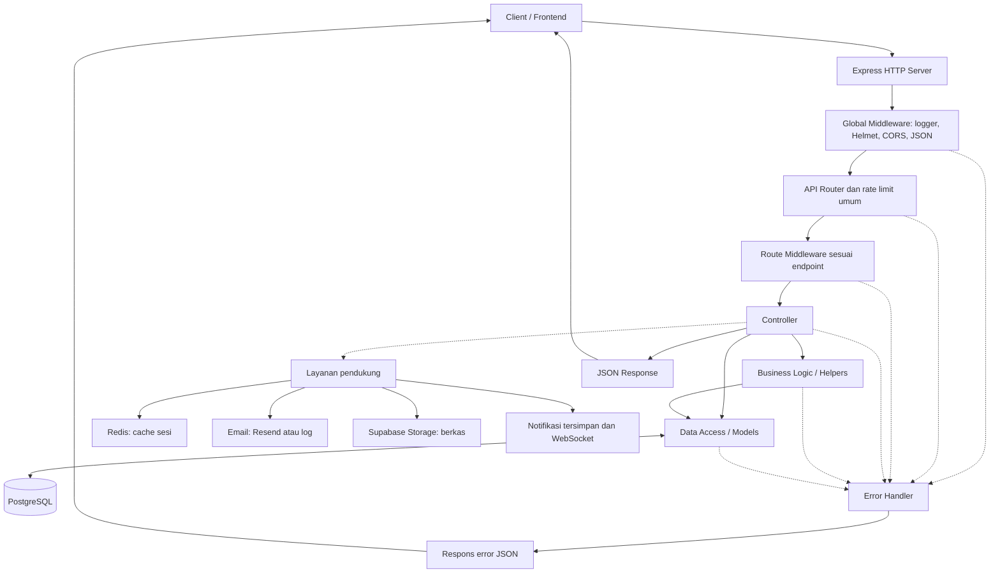

Model menulis SQL berparameter tanpa ORM. Controller dapat memanggil model langsung atau melalui helper. Penulisan beberapa tabel yang harus berhasil bersama memakai `withTransaction`.

### 2. Startup dan penghentian server

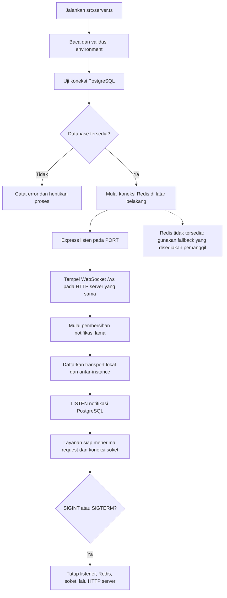

`/health` mengembalikan status server dan Redis; kondisi Redis tidak menentukan status HTTP health check.

### 3. Siklus request HTTP, izin, dan respons error

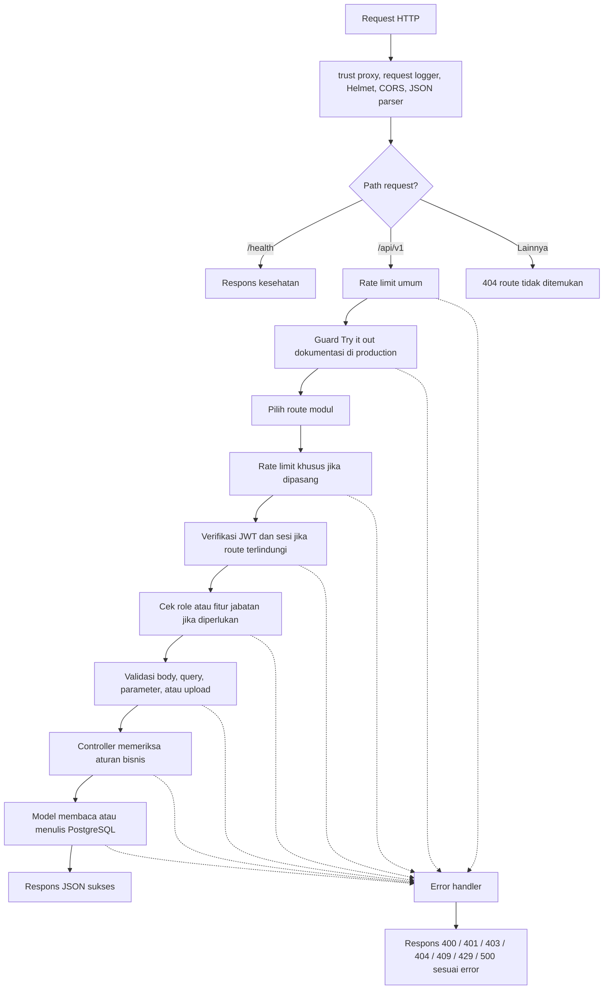

`authenticate` memverifikasi JWT lalu memeriksa token yang dicabut, keberadaan dan status akun, serta waktu perubahan password. Redis menyimpan cache sesi singkat; bila tidak siap, pemeriksaan memakai PostgreSQL. `requireFeature` membaca fitur jabatan; admin melewati pemeriksaan fitur. Validasi Zod menaruh body terparse di `req.body`, sedangkan query dan parameter terparse di `res.locals`. Error handler juga menangani JSON tidak valid dan pelanggaran UNIQUE database.

### 4. Pendaftaran, verifikasi, persetujuan akun, dan login

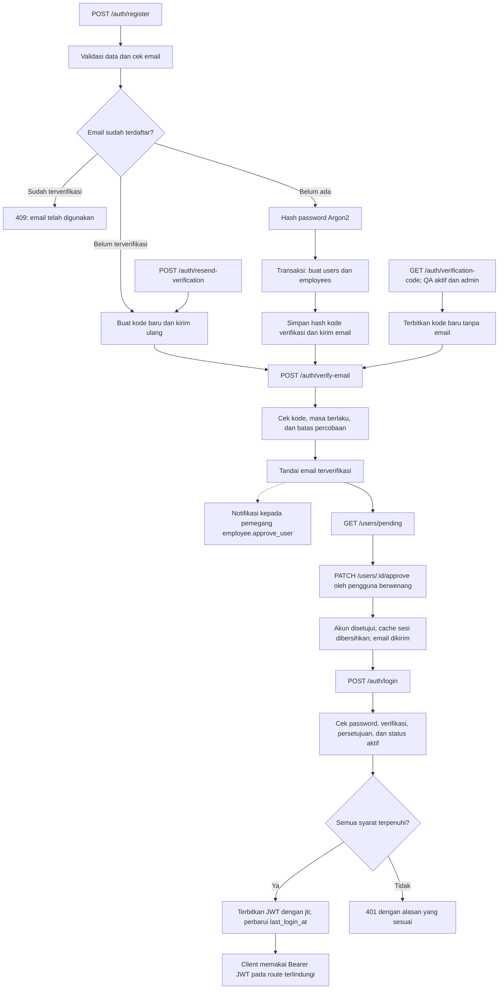

Registrasi mandiri membuat akun dan karyawan dalam satu transaksi. Pengajuan persetujuan baru terlihat sesudah email diverifikasi. Pembuatan karyawan oleh pemegang `employee.create` mengikuti alur terpisah pada diagram 6.

### 5. Sesi, profil sendiri, password, dan reset password

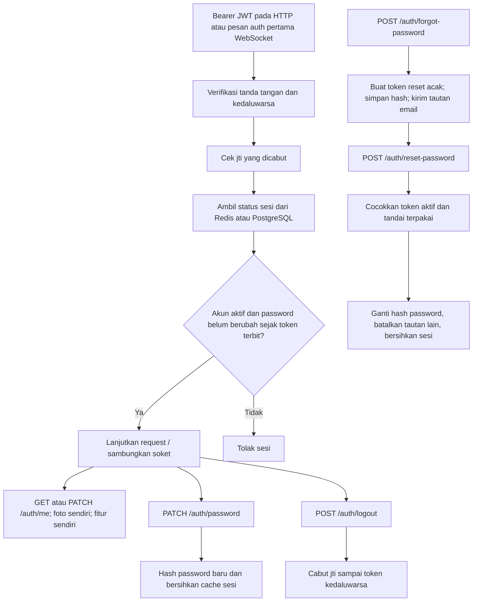

Endpoint `PATCH /users/:id/status` dapat menonaktifkan akun dan membersihkan cache sesi. Foto profil diproses melalui alur berkas pada diagram 12.

### 6. Karyawan dan akun yang dibuat oleh pengelola

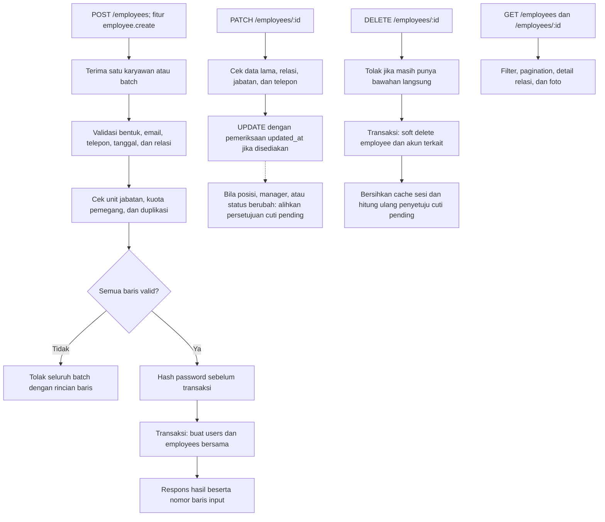

Update jabatan memakai versi `updated_at` bila dikirim. Pembuatan batch bersifat seluruhnya berhasil atau seluruhnya dibatalkan.

### 7. Unit organisasi, jabatan, fitur, dan data referensi

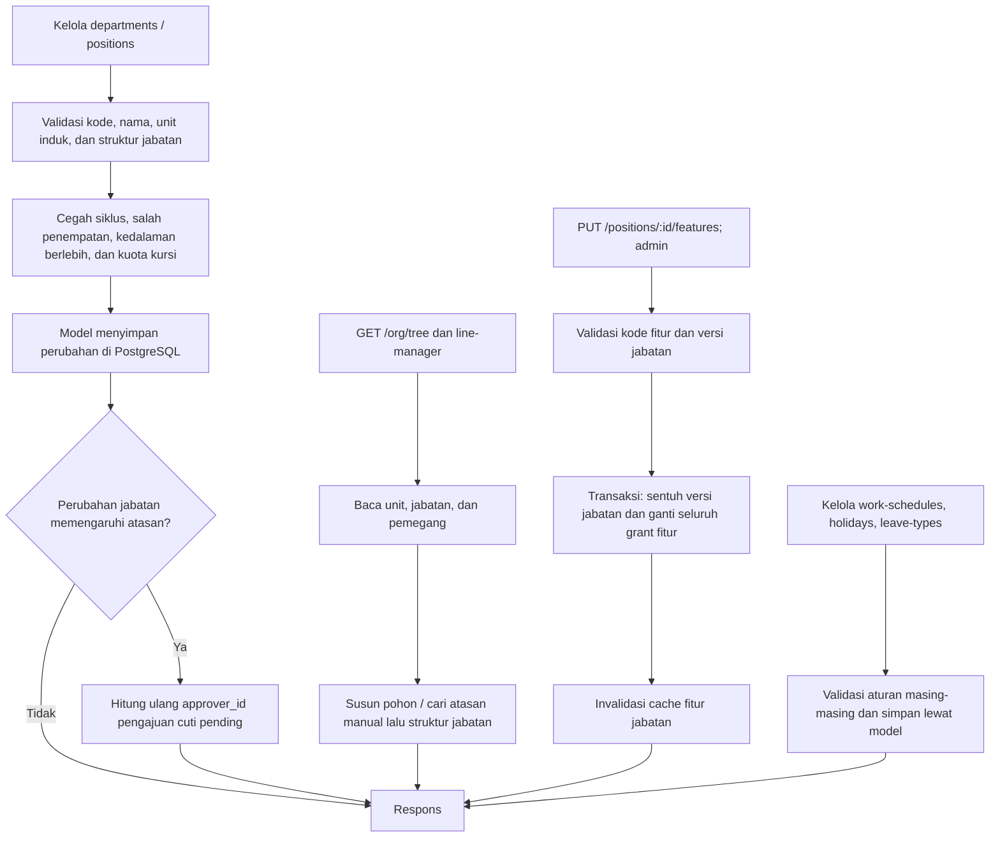

`departments` menyimpan unit bertingkat; `positions` menyimpan atasan jabatan; `employees` memegang jabatan. Atasan manual `manager_id` dipakai lebih dulu bila aktif, lalu sistem naik melalui rantai jabatan. Pembacaan katalog fitur dan matriks khusus admin, sedangkan `GET /me/features` menunjukkan fitur pengguna. Penghapusan unit atau jabatan yang masih dipakai ditolak. Jadwal berlaku menurut prioritas: jadwal karyawan, jadwal unit, lalu jadwal global.

### 8. Absensi masuk, pulang, dan sinkronisasi offline

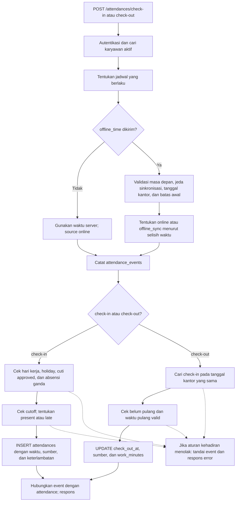

`attendance_events` baru dibuat sesudah karyawan, jadwal, dan waktu absensi valid. Waktu offline adalah klaim klien yang dibatasi; waktu penerimaan server dan `source` disimpan agar dapat diaudit. Satu tanggal kantor hanya memiliki satu baris absensi per karyawan.

### 9. Penutup hari, koreksi, dan laporan absensi

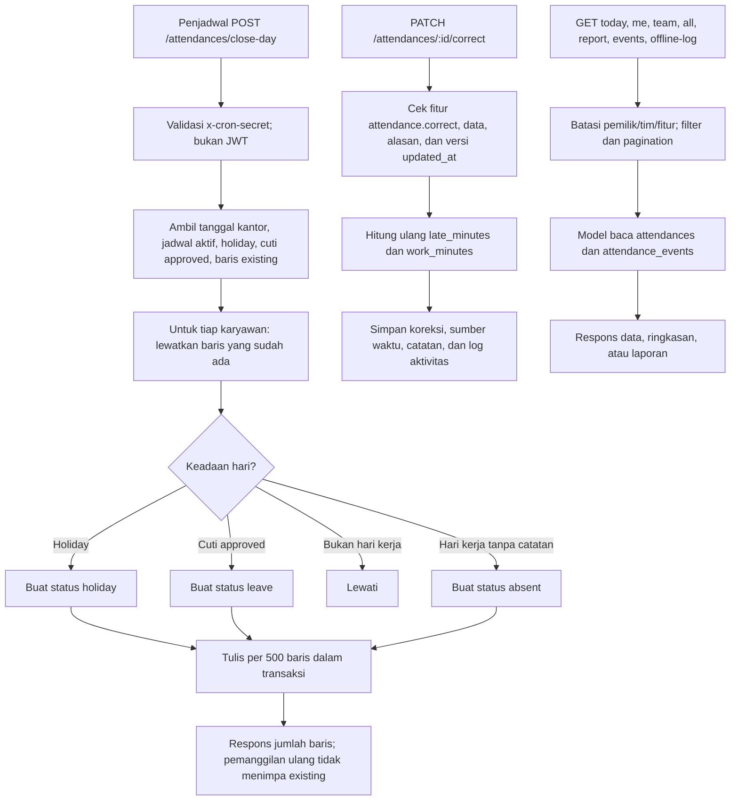

Koreksi yang tidak mengubah waktu mempertahankan sumber waktu sebelumnya; perubahan waktu menggunakan sumber `correction`. Laporan event dan offline-log membaca jejak yang berbeda dari baris hasil absensi.

### 10. Pengajuan cuti, keputusan, dan ledger saldo

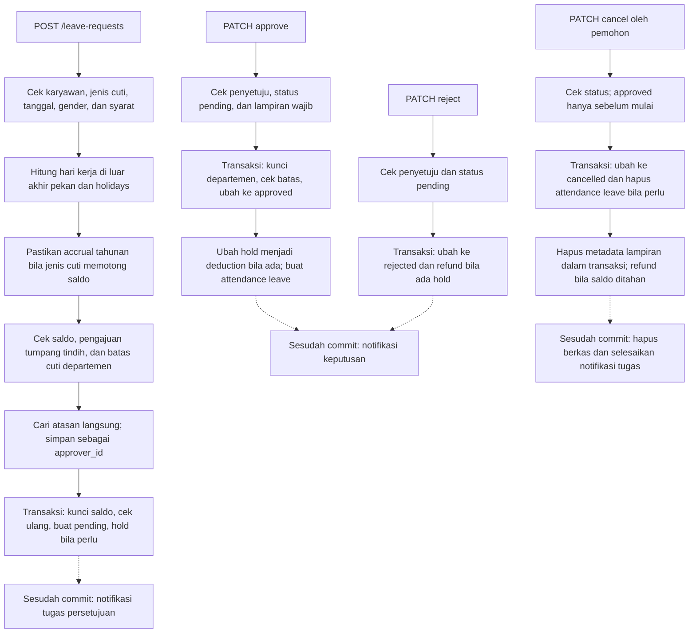

Penyetuju yang ditunjuk memerlukan `leave.approve_team`; pemegang `leave.approve_all` atau admin dapat memutus lebih luas. Tidak ada pengguna yang boleh memutus cutinya sendiri. Transisi status yang diizinkan: `pending` ke `approved`, `rejected`, atau `cancelled`; `approved` ke `cancelled` sebelum tanggal mulai. Perubahan status bersaing dicegah pada query update dan dijawab sebagai konflik.

### 11. Saldo cuti, kalender, dan daftar pengajuan

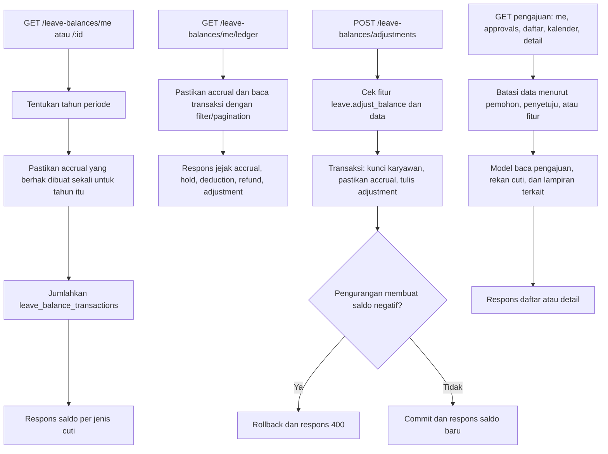

Saldo adalah penjumlahan ledger, bukan kolom saldo tunggal. `accrual` menambah jatah; `hold` menahan saat pengajuan; `deduction` mengganti hold setelah disetujui; `refund` mengembalikan; `adjustment` mencatat koreksi. Accrual diberikan saat dibutuhkan untuk tahun yang memenuhi syarat.

### 12. Foto karyawan dan lampiran cuti

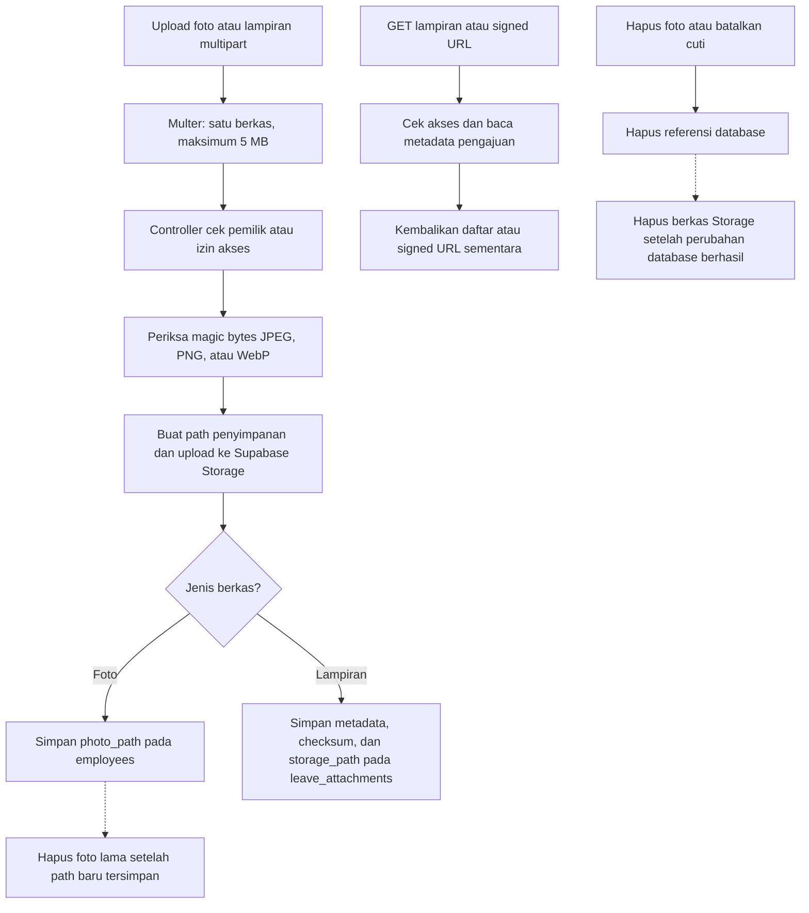

Nama asli berkas tidak menjadi satu-satunya dasar path. Lampiran cuti privat diakses lewat signed URL; URL itu diterbitkan ketika diminta, bukan disimpan permanen di database.

### 13. Notifikasi, WebSocket, dan banyak instance

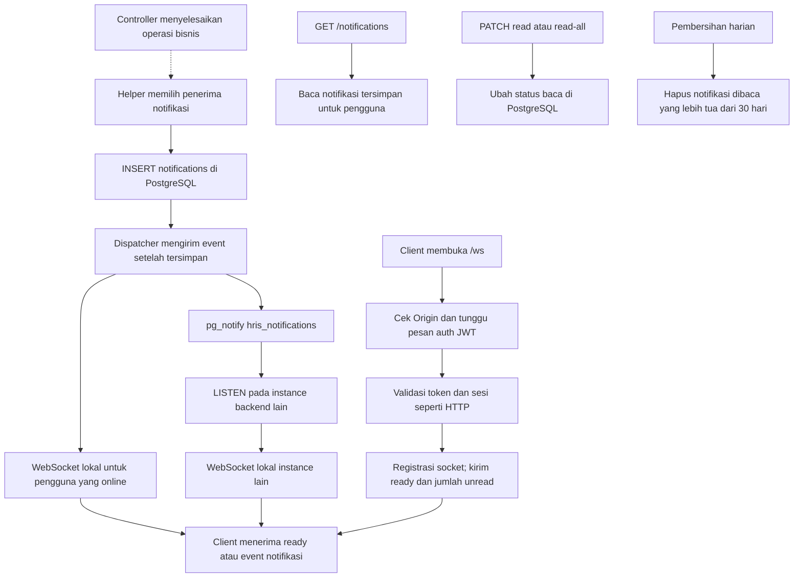

WebSocket memakai JWT sebagai pesan pertama, bukan bagian dari URL. Operasi menandai dibaca tetap melalui REST. Kegagalan pengiriman realtime tidak menghilangkan notifikasi yang telah tersimpan; pengguna dapat mengambilnya lewat `GET /notifications`. Notifikasi dan log aktivitas yang dijalankan sebagai efek tambahan tidak membatalkan operasi bisnis yang telah berhasil.

### 14. Dokumentasi API, log aktivitas, dan pembacaan umum

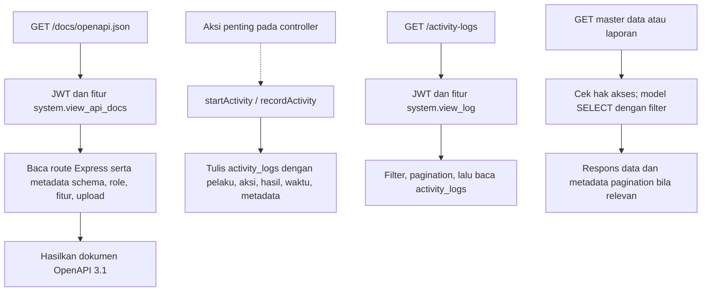

Di production, permintaan yang mengubah data dari fitur _Try it out_ dokumentasi ditolak oleh guard tambahan. Log aktivitas disimpan tanpa menahan respons utama; kegagalan pencatatannya ditulis ke log server.

### Peta diagram ke kode

| Diagram                          | Berkas utama                                                                                                                                                      |
| -------------------------------- | ----------------------------------------------------------------------------------------------------------------------------------------------------------------- |
| Startup dan HTTP                 | `src/server.ts`, `src/app.ts`, `src/route/route.ts`                                                                                                               |
| Middleware dan sesi              | `src/middlewares/`, `src/helpers/sessionStore.ts`, `src/helpers/jwt.ts`                                                                                           |
| Akun                             | `src/controller/accountVerificationController.ts`, `src/controller/authController.ts`, `src/controller/userAccountController.ts`                                  |
| Karyawan dan organisasi          | `src/controller/employeeController.ts`, `src/controller/departmentController.ts`, `src/controller/positionController.ts`, `src/models/orgStructure.ts`            |
| Jadwal, libur, jenis cuti, fitur | `src/controller/workScheduleController.ts`, `src/controller/holidayController.ts`, `src/controller/leaveTypeController.ts`, `src/controller/featureController.ts` |
| Absensi                          | `src/controller/attendanceController.ts`, `src/models/attendance.ts`, `src/models/attendanceEvent.ts`                                                             |
| Cuti dan saldo                   | `src/controller/leaveRequestController.ts`, `src/controller/leaveBalanceController.ts`, `src/models/leaveBalance.ts`                                              |
| Berkas                           | `src/controller/employeePhotoController.ts`, `src/controller/leaveAttachmentController.ts`, `src/helpers/storage.ts`                                              |
| Notifikasi dan realtime          | `src/helpers/notify.ts`, `src/controller/notificationController.ts`, `src/realtime/`                                                                              |
| Dokumentasi dan audit            | `src/docs/`, `src/controller/docsController.ts`, `src/helpers/activityLog.ts`                                                                                     |
| Database                         | `database/schema.sql`, `database/migrations/`                                                                                                                     |
